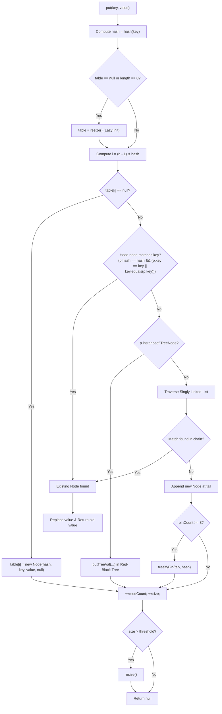

# 02. The Lifecycle of Put, Get, and Resize

## 1. Step-by-Step Flow of `put(K key, V value)`

The `put()` operation in `java.util.HashMap` executes through the internal method `putVal(...)`.



### Detailed Phase Breakdown

### Phase 1: Hash Calculation & Null Key Handling
1. If `key == null`, `hash` is assigned `0`. Null keys are always stored in **bucket 0**.
2. If `key != null`, the perturbation function is applied: `(h = key.hashCode()) ^ (h >>> 16)`.

### Phase 2: Lazy Initialization
1. When `new HashMap<>()` is instantiated, **no array is allocated in memory yet** (only `loadFactor` is set).
2. On the first `put()` invocation, `table == null` triggers `resize()`, which allocates the default array of length `16` and computes threshold `12`.

### Phase 3: Bucket Index Determination
1. Bucket index is computed: `i = (n - 1) & hash`.
2. If `table[i] == null`, there is no collision. A new `Node` is instantiated and assigned directly to `table[i]`.

### Phase 4: Collision Resolution
If `table[i] != null`, a collision occurs:
1. **Head Node Check**:
   First, test the bucket's head node `p`:
   ```java
   if (p.hash == hash && ((k = p.key) == key || (key != null && key.equals(k))))
       e = p;
   ```
   *Notice the optimization*: `==` is evaluated first. If reference equality holds (identical object in memory), `equals()` is skipped entirely!
2. **Red-Black Tree Check**:
   If `p instanceof TreeNode`, the bucket has already been treeified. It delegates to `putTreeVal()`, which traverses and balances the Red-Black tree in $O(\log n)$.
3. **Linked List Traversal**:
   If it is a plain singly linked list, it traverses to the tail:
   - For every node, it checks if `p.hash == hash && key.equals(p.key)`. If found, it marks that node for replacement.
   - If end of list is reached (`p.next == null`), the new node is **appended to the tail** (Java 8).
   - If chain length reaches `TREEIFY_THRESHOLD = 8`, `treeifyBin()` is called.

### Phase 5: Existing Value Update
If a matching key was found:
```java
if (e != null) { // existing mapping for key
    V oldValue = e.value;
    if (!onlyIfAbsent || oldValue == null)
        e.value = value;
    afterNodeAccess(e);
    return oldValue;
}
```
*(Notice: replacing an existing value does NOT increment `modCount` or `size`, and does NOT trigger resizing!)*

### Phase 6: Post-Insertion & Resizing
1. `modCount++`: Tracks structural changes for fail-fast iterators.
2. `size++`: Increments total element count.
3. If `size > threshold`, `resize()` is invoked.

---

## 2. Step-by-Step Flow of `get(Object key)`

The lookup algorithm in `getNode(...)` is optimized for maximum speed on non-colliding buckets:

```java
final Node<K,V> getNode(Object key) {
    Node<K,V>[] tab; Node<K,V> first, e; int n, hash; K k;
    if ((tab = table) != null && (n = tab.length) > 0 &&
        (first = tab[(n - 1) & (hash = hash(key))]) != null) {
        
        // Fast-path: Check first node in the bucket immediately
        if (first.hash == hash && 
            ((k = first.key) == key || (key != null && key.equals(k))))
            return first;
            
        // Slow-path: More than one node in bucket
        if ((e = first.next) != null) {
            if (first instanceof TreeNode)
                return ((TreeNode<K,V>)first).getTreeNode(hash, key); // O(log n)
            do {
                if (e.hash == hash &&
                    ((k = e.key) == key || (key != null && key.equals(k))))
                    return e; // O(n)
            } while ((e = e.next) != null);
        }
    }
    return null; // Key not present
}
```

### Distinguishing Missing Key vs. Null Value

Because HashMap supports `null` values:
```java
map.put("Alice", null);

map.get("Alice"); // returns null
map.get("Bob");   // returns null (key not in map!)
```
To differentiate between a key that doesn't exist versus a key mapped to a `null` value:
- Use `map.containsKey(key)`: Returns `true` for `"Alice"`, `false` for `"Bob"`.

---

## 3. Resizing and Rehashing Deep Dive

When total elements in the map exceed `threshold` (`capacity * loadFactor`), `resize()` is called.
In Java 8, capacity doubles: `newCap = oldCap << 1`.

### Java 7 vs. Java 8 Resizing Comparison

| Feature | Java 7 | Java 8 |
| :--- | :--- | :--- |
| **Insertion Strategy** | Head insertion (reversed chain) | Tail insertion (preserved order) |
| **Rehashing Method** | Re-computes index for every single element | High-bit partition without re-indexing |
| **Concurrency Danger** | Infinite loop (circular linked list) | No infinite loop (still vulnerable to data loss) |

---

## 4. The Java 8 High-Bit Partition Optimization

In older versions of Java, resizing required re-evaluating the index formula for every single node:
$$\text{newIndex} = \text{hash} \ \& \ (\text{newCap} - 1)$$

Java 8 introduced an ingenious mathematical shortcut: **The High-Bit Test**.

### The Principle

Because capacity always doubles by powers of two ($16 \to 32 \to 64$), the binary representation of `newCap - 1` differs from `oldCap - 1` by exactly **one new bit** (the bit corresponding to `oldCap`).

For example, resizing from $16$ ($2^4$) to $32$ ($2^5$):
- `oldCap - 1 = 15 = 0000 1111`
- `newCap - 1 = 31 = 0001 1111`

The new index is determined **solely** by whether the bit at position $2^4$ (16) in `hash` is `0` or `1`:
- If `(hash & oldCap) == 0`: That bit is `0`. The index remains **exactly the same**:
  $$\text{newIndex} = \text{oldIndex}$$
- If `(hash & oldCap) != 0`: That bit is `1`. The index shifts by `oldCap`:
  $$\text{newIndex} = \text{oldIndex} + \text{oldCap}$$

### Concrete Example

Suppose `oldCap = 16`.
- Key A: `hash = 0010 0101` (37)
  - `hash & (16 - 1) = 37 & 15 = 5` (Old index: 5)
  - Check bit: `hash & oldCap = 37 & 16 = 0010 0101 & 0001 0000 = 0000 0000 = 0`
  - New index: $5$ (Stays at 5!)
- Key B: `hash = 0011 0101` (53)
  - `hash & (16 - 1) = 53 & 15 = 5` (Old index: 5)
  - Check bit: `hash & oldCap = 53 & 16 = 0011 0101 & 0001 0000 = 0001 0000 != 0`
  - New index: $5 + 16 = 21$!

### The Two Sub-Chain Split (`loHead` & `hiHead`)

During `resize()`, Java 8 walks the bucket chain and splits it into two separate chains using 4 pointers:
1. `loHead`, `loTail`: Nodes where `(hash & oldCap) == 0` (placed at `newTable[j]`).
2. `hiHead`, `hiTail`: Nodes where `(hash & oldCap) != 0` (placed at `newTable[j + oldCap]`).

```java
Node<K,V> loHead = null, loTail = null;
Node<K,V> hiHead = null, hiTail = null;
Node<K,V> next;
do {
    next = e.next;
    if ((e.hash & oldCap) == 0) {
        if (loTail == null)
            loHead = e;
        else
            loTail.next = e;
        loTail = e;
    } else {
        if (hiTail == null)
            hiHead = e;
        else
            hiTail.next = e;
        hiTail = e;
    }
} while ((e = next) != null);

if (loTail != null) {
    loTail.next = null;
    newTab[j] = loHead; // Same index
}
if (hiTail != null) {
    hiTail.next = null;
    newTab[j + oldCap] = hiHead; // Shifted index
}
```

### Advantages of This Optimization:
1. **Zero Hash Computations**: No modulo or bitwise arithmetic across all nodes.
2. **Preserved Node Ordering**: Because nodes are appended to `loTail` and `hiTail`, their relative order is maintained.
3. **No Chain Reversal**: In Java 7, inserting at the head reversed the chain order, which caused circular references when accessed concurrently. Java 8's tail insertion eliminates this specific bug.
