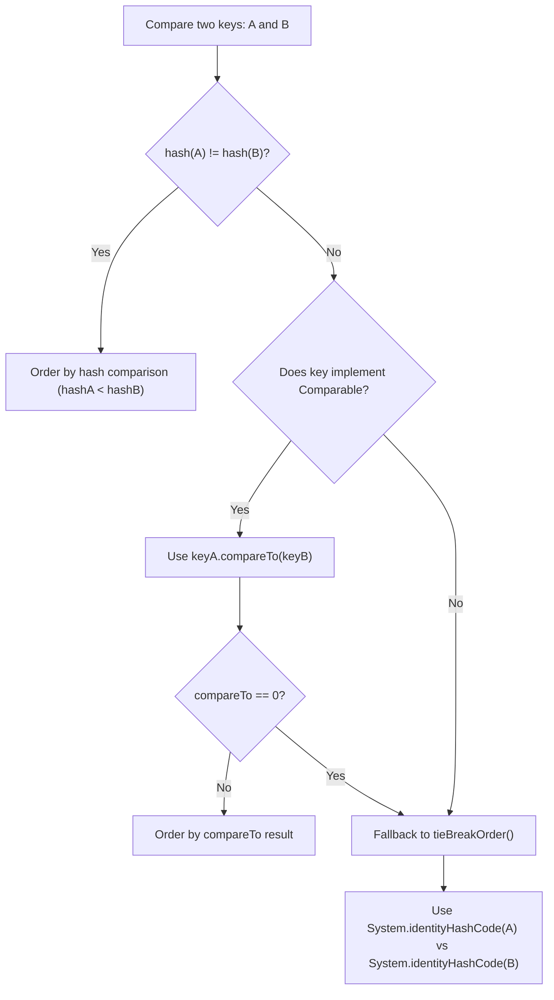

# 03. Treeification and Collision Handling

## 1. Collision Resolution Strategies: Chaining vs. Open Addressing

When two distinct keys produce identical bucket indices:
$$(n - 1) \ \& \ \text{hash}(K_1) == (n - 1) \ \& \ \text{hash}(K_2)$$

A collision occurs. Two primary collision resolution paradigms exist in computer science:

| Resolution Strategy | Mechanism | Pros | Cons |
| :--- | :--- | :--- | :--- |
| **Separate Chaining** *(Used by Java)* | Each bucket holds a pointer to a linked list (or balanced tree) of entries. | - Simple deletion.<br/>- Resilient under high load factors.<br/>- Never runs out of space. | Extra memory overhead for node pointers. |
| **Open Addressing** *(Linear / Quadratic Probing, Double Hashing)* | All entries stored directly in the array; collisions probe alternative array slots. | - Cache-friendly (contiguous array memory).<br/>- No pointer overhead. | - Severe clustering (primary & secondary).<br/>- Deletion requires tombstone markers.<br/>- Performance degrades sharply when load factor $> 0.7$. |

Java’s `HashMap` uses **Separate Chaining** because it guarantees stability, simplifies element deletion, and avoids complex probing loops under varying loads.

---

## 2. Java 8 Treeification Mechanism

Prior to Java 8, if an attacker maliciously submitted keys with identical `hashCode()` values (Hash Collision DoS Attack), all keys would accumulate in a single bucket. This transformed the map's lookup time from $O(1)$ to $O(n)$, causing 100% CPU spikes and thread starvation.

Java 8 introduced **Treeification**: converting deep linked list buckets into balanced **Red-Black Trees**, bringing worst-case performance down to $O(\log n)$.

```
Before Treeification (Singly Linked List - O(n)):
Bucket [3] ---> [Node A] ---> [Node B] ---> [Node C] ---> [Node D] ---> ... ---> [Node H]

After Treeification (Red-Black Tree - O(log n)):
Bucket [3] --->          [TreeNode D (Black)]
                        /                    \
             [TreeNode B (Red)]         [TreeNode F (Red)]
                /          \               /          \
          [Node A]       [Node C]     [Node E]      [Node G]
```

### The Two Conditions for Treeification

A bucket is **not** immediately converted into a Red-Black Tree just because it reaches 8 elements. Both of the following conditions must be satisfied:

```java
static final int TREEIFY_THRESHOLD = 8;
static final int MIN_TREEIFY_CAPACITY = 64;
```

1. **Bucket Depth Condition**: The number of colliding elements in that specific bucket must reach `TREEIFY_THRESHOLD = 8`.
2. **Table Capacity Condition**: The total table capacity must be at least `MIN_TREEIFY_CAPACITY = 64`.

### What happens if bucket length $\ge 8$, but table capacity $< 64$?

```java
final void treeifyBin(Node<K,V>[] tab, int hash) {
    int n, index; Node<K,V> e;
    if (tab == null || (n = tab.length) < MIN_TREEIFY_CAPACITY)
        resize(); // Resize instead of treeifying!
    else if ((e = tab[index = (n - 1) & hash]) != null) {
        // Actually convert bucket to TreeNodes
    }
}
```

If the table is small ($< 64$), HashMap assumes the collision is caused by having too few buckets rather than a pathological hash function. It triggers `resize()` to double the capacity, which automatically redistributes the collided keys across newly created buckets.

---

## 3. Why Red-Black Trees (and Not AVL Trees)?

A Red-Black Tree is a self-balancing binary search tree that satisfies 5 structural invariants:
1. Every node is either **Red** or **Black**.
2. The root node is always **Black**.
3. All leaf nodes (`NIL` nodes) are **Black**.
4. If a node is **Red**, both of its children must be **Black** (no two consecutive red nodes).
5. Every simple path from any node to its descendant leaves contains the **exact same number of black nodes** (the "Black Height").

### Red-Black Tree vs. AVL Tree

| Property | AVL Tree | Red-Black Tree (HashMap Choice) |
| :--- | :--- | :--- |
| **Balance Rigidity** | Strictly balanced: $\|height(L) - height(R)\| \le 1$. | Loosely balanced: longest path is at most twice the shortest path. |
| **Lookup Performance** | Marginally faster ($O(\log n)$ with a smaller constant). | Fast ($O(\log n)$). |
| **Insertion / Deletion Performance** | Slower; requires frequent recursive rotations to restore strict balance. | **Significantly faster**; requires at most 2 rotations for insert and 3 for delete. |
| **Use Case Fit** | Read-heavy static datasets. | **Dynamic read-write workloads** like HashMaps. |

Because `HashMap` is subject to continuous inserts and deletes, the lower rebalancing overhead of Red-Black Trees provides optimal real-world throughput.

---

## 4. Untreeification and Hysteresis

During resizing or deletion, if the number of elements in a treeified bucket drops, HashMap converts it back into a standard singly linked list:

```java
static final int UNTREEIFY_THRESHOLD = 6;
```

### Why is `UNTREEIFY_THRESHOLD = 6` instead of `8`? (The Hysteresis Principle)

If `UNTREEIFY_THRESHOLD` were set to `8` (or `7`), a program that repeatedly inserts and removes a single element near the boundary would cause **thrashing**:
```
Insert 8th node  ---> Convert List to Tree (Expensive!)
Remove 8th node  ---> Convert Tree to List (Expensive!)
Insert 8th node  ---> Convert List to Tree (Expensive!)
Remove 8th node  ---> Convert Tree to List (Expensive!)
```

By leaving a buffer gap of **2 elements** (between 6 and 8), HashMap ensures that temporary oscillations do not trigger repeated, expensive conversions.

---

## 5. Memory Footprint: `Node` vs. `TreeNode`

`TreeNode` maintains both tree pointers (`parent`, `left`, `right`) and linked list pointers (`prev`, `next`) so that it can iterate or untreeify rapidly:

```java
// Standard Singly Linked List Node (4 references/primitives)
static class Node<K,V> {
    final int hash;
    final K key;
    V value;
    Node<K,V> next;
}

// Tree Node (Extends LinkedHashMap.Entry, ~9 fields)
static final class TreeNode<K,V> extends LinkedHashMap.Entry<K,V> {
    TreeNode<K,V> parent;
    TreeNode<K,V> left;
    TreeNode<K,V> right;
    TreeNode<K,V> prev;
    boolean red;
    // Inherited from Node: hash, key, value, next
}
```

On a 64-bit JVM:
- A `Node` object consumes roughly **32 bytes**.
- A `TreeNode` object consumes roughly **56 to 64 bytes** (approximately **$2\times$ memory**).

This is why treeification is used conservatively: standard buckets retain lightweight `Node` instances to keep the memory footprint small.

---

## 6. Total Ordering Inside `TreeNode`

A Binary Search Tree requires elements to be totally ordered (`A < B`, `A > B`, or `A == B`) to decide whether to traverse left or right. What if colliding keys have the same hash code?

HashMap applies a 3-tier ordering strategy:



### Tie-Breaking with `tieBreakOrder()`:

```java
static int tieBreakOrder(Object a, Object b) {
    int d;
    if (a == null || b == null ||
        (d = a.getClass().getName().compareTo(b.getClass().getName())) == 0)
        d = (System.identityHashCode(a) <= System.identityHashCode(b) ? -1 : 1);
    return d;
}
```

This guarantees that every entry in a `TreeNode` bucket has a deterministic, strictly consistent position in the tree, even when keys do not implement `Comparable`.
