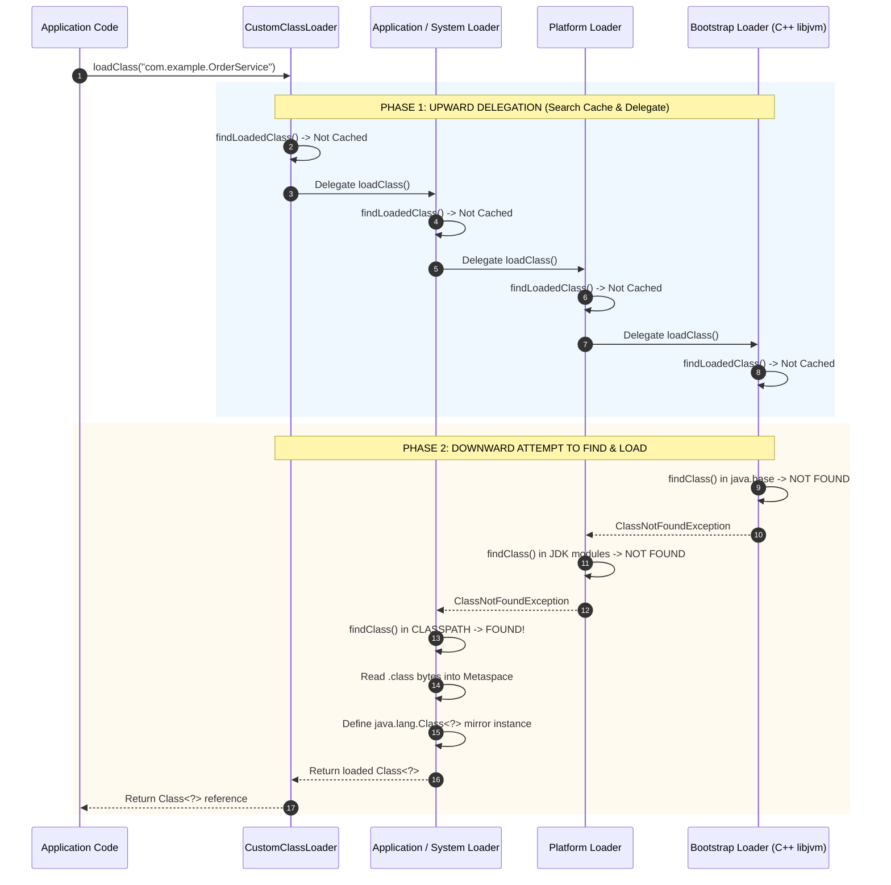

# Architectural Diagram: ClassLoader Lifecycle & Delegation Subsystem



---

## The Verification, Preparation & Initialization State Transitions

```mermaid
stateDiagram-v2
    [*] --> Raw_Bytes: Read from disk / network (0xCAFEBABE)
    
    state Linking {
        Raw_Bytes --> Verified: Pass 1-4 (Format, Semantics, StackMapTable, Symbols)
        Verified --> Prepared: Allocate static fields with zero defaults (0, null)
        Prepared --> Resolved: Replace constant pool symbols with direct memory pointers
    }
    
    Resolved --> Initialized: Execute &lt;clinit&gt; static blocks under VM lock
    Initialized --> Instantiated: Execute new + &lt;init&gt; constructor on Heap
    Instantiated --> [*]
```
