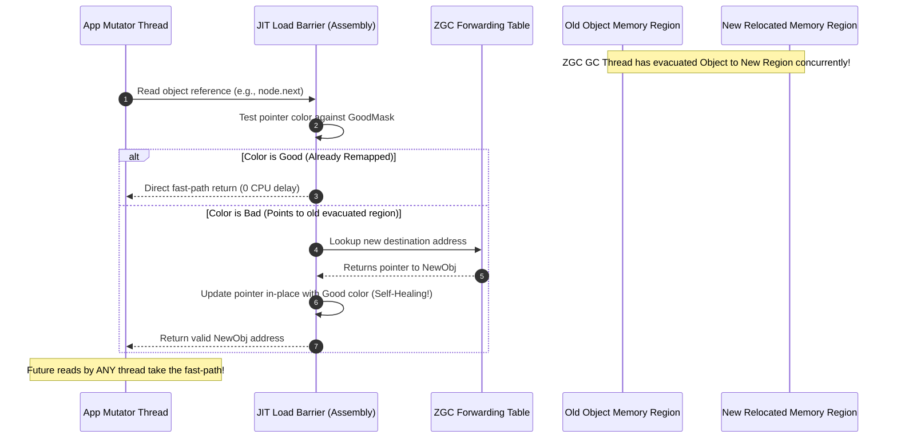

# Architectural Diagram: Garbage Collectors Evolution & ZGC Colored Pointers

## 1. HotSpot Card Table & Cross-Generational Write Barrier

```
  OLD GENERATION MEMORY (Heap):
  [ Card 0: 512B ] [ Card 1: 512B ] [ Card 2: 512B ] [ Card 3: 512B ]
         |                |                |                |
         v                v                v                v
  CARD TABLE (Byte Array in JVM Native Memory):
  [    0x00      ] [    0x01      ] [    0x00      ] [    0x00      ]
                      (DIRTY)
                         |
                         v (During Minor GC)
  Only scan objects in Card 1 for references to Young Generation!
  Eliminates full Old Generation scanning!
```

---

## 2. ZGC 64-Bit Colored Pointers Anatomy

```
  +-----------------------------------------------------------------------------------------+
  |                                64-BIT VIRTUAL POINTER IN ZGC                            |
  |                                                                                         |
  |  +--------------------+  +----------------------+  +---------------------------------+  |
  |  |   16 UNUSED BITS   |  |   4 METADATA BITS    |  |    44-BIT VIRTUAL HEAP OFFSET   |  |
  |  |   Bits [63 : 48]   |  |   Bits [47 : 44]     |  |    Bits [43 : 0]                |  |
  |  |   (Zero extended)  |  |                      |  |    (Addresses up to 16 TB Heap) |  |
  |  +--------------------+  +----------------------+  +---------------------------------+  |
  |                                      |                                                  |
  |               +----------------------+----------------------+                           |
  |               |                      |                      |                           |
  |               v                      v                      v                           |
  |        [Finalizable]             [Remapped]             [Marked1 / Marked0]             |
  |        Bit 47                    Bit 46                 Bits 45 & 44                    |
  |        Weak/Final reference      Object pointer has     Object is currently             |
  |        reachability check        been updated in-place  determined to be alive          |
  +-----------------------------------------------------------------------------------------+
```

---

## 3. ZGC Concurrent Relocation & Self-Healing Load Barrier


