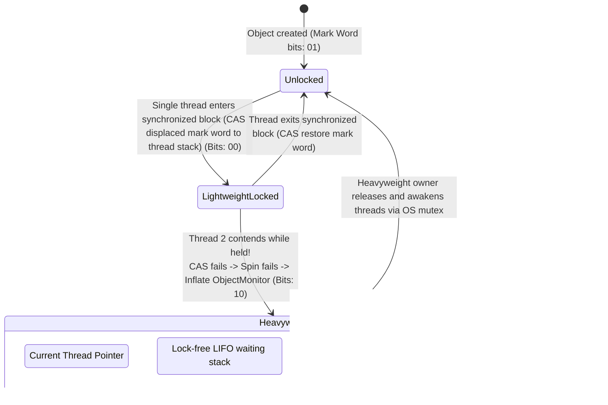
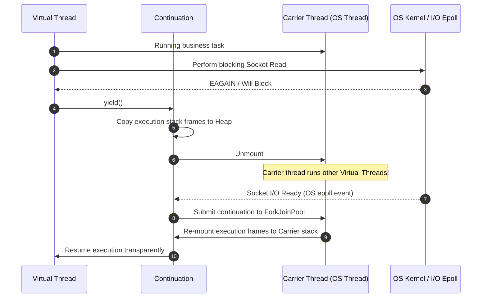

# Architectural Diagram: JMM, Cache Coherence & Monitor Inflation

## 1. Hardware False Sharing & 64-Byte Cache Lines

```
  PHYSICAL 64-BYTE L1 CPU CACHE LINE:
  +--------------------+--------------------+---------------------------------------------+
  | volatile long a    | volatile long b    | Remaining 48 bytes of adjacent memory       |
  | (8 bytes)          | (8 bytes)          |                                             |
  +--------------------+--------------------+---------------------------------------------+
            ^                    ^
            |                    |
        CPU Core 1           CPU Core 2
        (Thread A)           (Thread B)
            |                    |
            v                    v
  Writing 'a' invalidates the WHOLE 64-byte line on Core 2!
  Writing 'b' invalidates the WHOLE 64-byte line on Core 1!
  = Massive hardware bus contention and false sharing slowdown!
```

---

## 2. Monitor Locking & Inflation State Machine



---

## 3. Virtual Thread Lifecycle (Project Loom Continuation)


