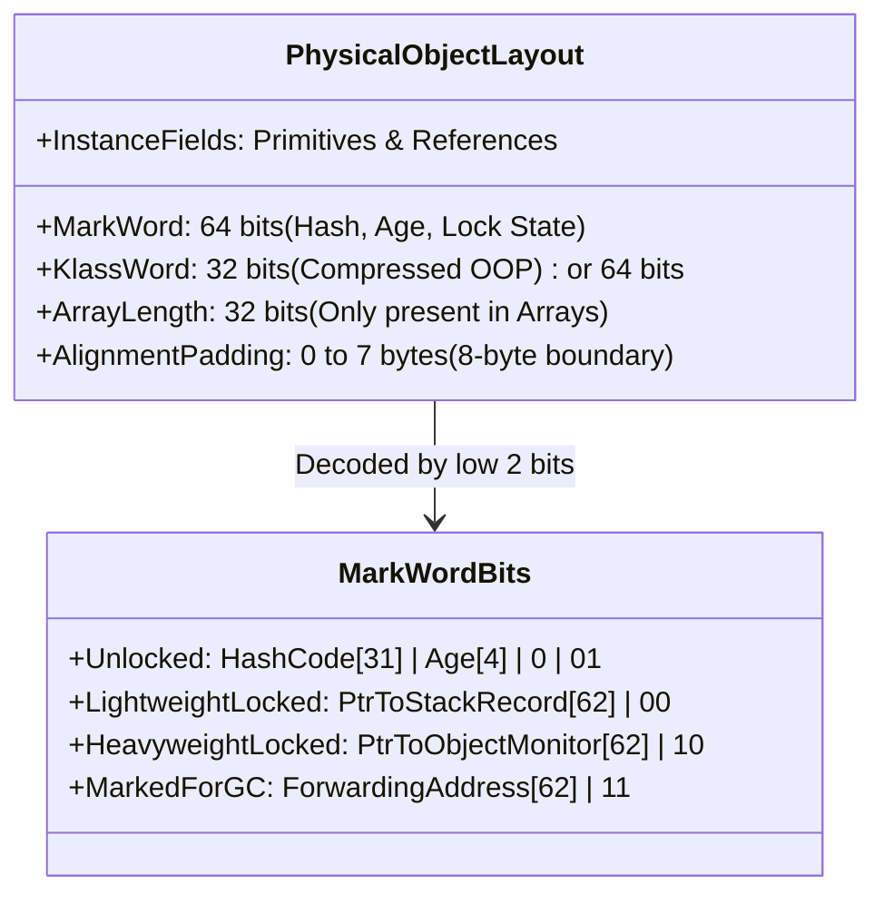

# Architectural Diagram: JVM Memory Layout & Object Anatomy

```
+----------------------------------------------------------------------------------------------------+
|                                    TOTAL JVM PROCESS MEMORY SPACE                                  |
|                                                                                                    |
|  +----------------------------------------------------------------------------------------------+  |
|  |                                  MANAGED JAVA HEAP (-Xms / -Xmx)                             |  |
|  |                                                                                              |  |
|  |  +-------------------------------------------------------------+  +-----------------------+  |  |
|  |  |                      YOUNG GENERATION                       |  |    OLD GENERATION     |  |  |
|  |  |  +---------------------------+  +-----------+  +-----------+  |  |   (TENURED SPACE)     |  |  |
|  |  |  |        EDEN SPACE         |  | SURVIVOR  |  | SURVIVOR  |  |  |                       |  |  |
|  |  |  |  [TLAB 1] [TLAB 2] [TLAB N]  |  | S0 (FROM) |  | S1 (TO)   |  |  | Long-lived objects     |  |  |
|  |  |  |  (Thread Local Buffers)   |  +-----------+  +-----------+  |  | promoted after        |  |  |
|  |  |  |  Fast Bump-the-pointer    |  Copied during Minor GC        |  | surviving N cycles    |  |  |
|  |  |  +---------------------------+  Aging threshold: 1 -> 15      |  |                       |  |  |
|  |  +-------------------------------------------------------------+  +-----------------------+  |  |
|  +----------------------------------------------------------------------------------------------+  |
|                                                                                                    |
|  +----------------------------------------------------------------------------------------------+  |
|  |                                  NATIVE MEMORY (OFF-HEAP)                                    |  |
|  |                                                                                              |  |
|  |  +---------------------------------------------+  +---------------------------------------+  |  |
|  |  |                  METASPACE                  |  |              CODE CACHE               |  |  |
|  |  |  - Klass Metadata (instanceKlass)           |  |  - Compiled native assembly code      |  |  |
|  |  |  - Runtime Constant Pool                    |  |  - Inlined compiled methods           |  |  |
|  |  |  - Method Bytecode & Annotations            |  |  - Compiler buffers                   |  |  |
|  |  |  - Compressed Class Space (32-bit pointers) |  +---------------------------------------+  |  |
|  |  +---------------------------------------------+  +---------------------------------------+  |  |
|  |  +---------------------------------------------+  |         GC TABLES & INTERNAL          |  |  |
|  |  |            DIRECT MEMORY BUFFER             |  |  - Card Tables & Remembered Sets      |  |  |
|  |  |  - ByteBuffer.allocateDirect()              |  |  - Mark Bitmaps & Forwarding Tables   |  |  |
|  |  |  - Panama Arena Off-Heap Segments           |  |  - String Table (SymbolTable)         |  |  |
|  |  +---------------------------------------------+  +---------------------------------------+  |  |
|  +----------------------------------------------------------------------------------------------+  |
|                                                                                                    |
|  +----------------------------------------------------------------------------------------------+  |
|  |                              PER-THREAD STACK MEMORY (-Xss)                                  |  |
|  |  Thread 1 Stack           Thread 2 Stack           Thread N Stack                            |  |
|  |  +--------------------+   +--------------------+   +--------------------+                    |  |
|  |  | Stack Frame 3      |   | Stack Frame 2      |   | Stack Frame 1      |                    |  |
|  |  | - Local Var Array  |   | - Local Var Array  |   | - Local Var Array  |                    |  |
|  |  | - Operand Stack    |   | - Operand Stack    |   | - Operand Stack    |                    |  |
|  |  | - Dynamic Linking  |   | - Dynamic Linking  |   | - Dynamic Linking  |                    |  |
|  |  +--------------------+   +--------------------+   +--------------------+                    |  |
|  +----------------------------------------------------------------------------------------------+  |
+----------------------------------------------------------------------------------------------------+
```

---

## Physical Java Object Header Layout in 64-Bit HotSpot


