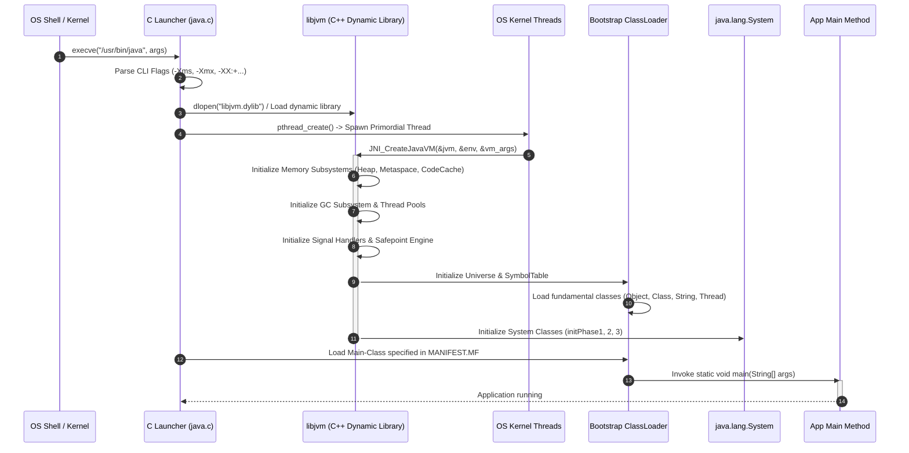

# 01. JDK, JRE, JVM & Runtime Architecture

---

## 1. The Java Runtime Triad: Architectural Decomposition

To a junior engineer, Java is simply a programming language with an installer. To a Principal Architect, Java is a layered abstraction system composed of three distinct tiers:

```
+-----------------------------------------------------------------------------------------+
|                               JAVA DEVELOPMENT KIT (JDK)                                |
|  +-----------------------------------------------------------------------------------+  |
|  | Compiler (javac) | Archiver (jar) | Debugger (jdb) | Disassembler (javap)          |  |
|  | Profiling & Observability: jcmd, jstack, jmap, jstat, jhsdb, jfr, jconsole         |  |
|  | Native Interop: javac -h, jextract | Modular Linker: jlink                         |  |
|  |-----------------------------------------------------------------------------------|  |
|  |                             JAVA RUNTIME ENVIRONMENT (JRE)                        |  |
|  |  +-----------------------------------------------------------------------------+  |  |
|  |  | Standard Class Libraries: java.base, java.sql, java.net, java.util, etc.    |  |  |
|  |  | Security Providers, Root Certificates, Timezone data, Configuration files    |  |  |
|  |  |-----------------------------------------------------------------------------|  |  |
|  |  |                           JAVA VIRTUAL MACHINE (JVM)                        |  |  |
|  |  |  +-----------------------------------------------------------------------+  |  |  |
|  |  |  | ClassLoader Subsystem | Runtime Memory Areas | Execution Engine (JIT)|  |  |  |
|  |  |  | Garbage Collector    | Native Interface (JNI/FFM) | OS Abstraction  |  |  |  |
|  |  |  +-----------------------------------------------------------------------+  |  |  |
|  |  +-----------------------------------------------------------------------------+  |  |
|  +-----------------------------------------------------------------------------------+  |
+-----------------------------------------------------------------------------------------+
```

### The Three Tiers Explained

| Tier | Definition | Purpose | Key Artifacts |
| :--- | :--- | :--- | :--- |
| **JDK** *(Java Development Kit)* | The full superset containing tools, compilers, debuggers, monitors, and runtime libraries required to build, test, and profile Java software. | Development, compilation, profiling, build pipelines, and production container images. | `bin/javac`, `bin/javap`, `bin/jcmd`, `bin/jstack`, `bin/jmap`, `bin/jfr` |
| **JRE** *(Java Runtime Environment)* | The minimum software environment necessary to execute a pre-compiled Java program. Contains standard libraries and the JVM. | Execution-only target (historically distributed to end-users). | `lib/modules` (formerly `rt.jar`), native launcher `bin/java` |
| **JVM** *(Java Virtual Machine)* | The abstract computing engine specification and its concrete native implementations (e.g., HotSpot) that interpret bytecode and translate it into machine code. | Hardware virtualization, memory management, garbage collection, thread scheduling, and hardware acceleration. | `lib/server/libjvm.so` (Linux), `libjvm.dylib` (macOS), `jvm.dll` (Windows) |

---

## 2. The Architectural Demise of the Standalone JRE (Java 9+ and 11)

In Java 8 and earlier, Oracle shipped two distinct downloads: the **JDK** (~200MB) and the **JRE** (~50MB). Every desktop and server installed a monolithic JRE containing `rt.jar` (Run-Time Jar, ~60MB of uncompressed bytecode covering everything from Swing and CORBA to crypto and collections).

### Why the JRE was Abolished (JEP 220 & JEP 261: Project Jigsaw)
1. **The Monolithic `rt.jar` Problem:** Even a microscopic microservice printing `"Hello World"` was forced to load a monolithic runtime containing legacy Enterprise JavaBeans, XML binding, and desktop GUI libraries.
2. **Containerization & Cloud Footprints:** In the Docker/Kubernetes era, shipping a bloated 250MB runtime base image for a 10MB microservice wasted gigabytes of cluster memory and storage.
3. **Internal API Encapsulation:** Unsafe internal classes like `sun.misc.Unsafe` and `com.sun.*` were freely accessible across the classpath, causing massive breakage whenever internal JVM implementations changed.

### The Modern Alternative: Modular Runtime Images & `jlink`
Since Java 11, the standalone JRE is no longer distributed. Instead:
- All platform classes are compiled into a highly optimized, indexed binary image format located at `<JAVA_HOME>/lib/modules` (JEP 220).
- Architects use **`jlink` (The Java Linker)** to strip away unused modules and create a custom, self-contained runtime image as small as **25MB - 35MB** containing *only* the specific modules required by their application:

```bash
# Example: Creating a stripped, production-hardened micro-runtime containing only java.base and java.net.http
jlink \
  --module-path $JAVA_HOME/jmods \
  --add-modules java.base,java.net.http \
  --strip-debug \
  --compress 2 \
  --no-header-files \
  --no-man-pages \
  --output custom-micro-runtime
```

---

## 3. The JVM: Specification vs Implementation vs Runtime Instance

A Senior Architect distinguishes between three uses of the word "JVM":

```
  +-----------------------------------------------------------------------------+
  | 1. THE SPECIFICATION (The Contract)                                         |
  |    The Java Virtual Machine Specification (JSR-XXX) written by Sun/Oracle.  |
  |    Defines the class file format (0xCAFEBABE), bytecode instruction opcodes,|
  |    the abstract stack machine, and memory consistency rules.                |
  +-----------------------------------------------------------------------------+
                                       |
                                       v (Implemented by)
  +-----------------------------------------------------------------------------+
  | 2. THE IMPLEMENTATION (The Native Binary Code)                              |
  |    A concrete software program written primarily in C++ and assembly that   |
  |    faithfully fulfills the specification on physical hardware.              |
  |    - HotSpot (OpenJDK / Oracle - Universal Industry Standard)               |
  |    - Eclipse OpenJ9 (IBM - Optimized for low memory footprint)              |
  |    - GraalVM (Oracle Labs - Polyglot & Substrate AOT Native Image)          |
  |    - Azul Zing / Prime (Azul Systems - C4 pauseless GC & Falcon JIT)        |
  +-----------------------------------------------------------------------------+
                                       |
                                       v (Instantiated as)
  +-----------------------------------------------------------------------------+
  | 3. THE RUNTIME INSTANCE (The Operating System Process)                      |
  |    An active OS process running in user space with a dedicated Virtual      |
  |    Memory address space, kernel threads, file descriptors, and PID.         |
  +-----------------------------------------------------------------------------+
```

---

## 4. HotSpot C++ Core Architecture

OpenJDK HotSpot is written in C++ (over 1.5 million lines of code). Its source tree (`src/hotspot/share/`) reveals its true structure:

```
src/hotspot/share/
├── classfile/       <-- Class loading, class file parser, system dictionary
├── memory/          <-- Metaspace, universe, allocation buffers
├── oop/             <-- Ordinary Object Pointers (instanceOop, arrayOop, markWord)
├── runtime/         <-- Threads, monitors, safepoints, arguments, reflection
├── interpreter/     <-- Template interpreter, bytecode execution loop
├── c1/              <-- Client JIT compiler (fast compilation, simple optimizations)
├── opto/            <-- C2 Server JIT compiler (Ideal graph, high-level IR optimizations)
├── gc/              <-- Garbage Collection implementations:
│   ├── g1/          <-- Garbage-First Collector
│   ├── z/           <-- Z Garbage Collector (Colored Pointers, Load Barriers)
│   ├── parallel/    <-- Parallel throughput collector
│   └── shared/      <-- Common GC barriers, card tables, remembered sets
└── primitives/      <-- JVM intrinsics, JNI native bridges, memory barriers
```

---

## 5. JVM Bootstrapping Sequence: From `java -jar` to `main()`

When an architect types `java -jar application.jar`, what occurs at the OS and CPU level before a single line of Java business code runs?



### Detailed Step-by-Step Walkthrough

#### Step 1: Binary Launch & CLI Argument Parsing
The OS kernel executes the native launcher binary (`java.exe` on Windows, ELF `java` on Linux, Mach-O `java` on macOS).
The launcher initializes in C (`src/java.base/share/native/launcher/main.c` and `java.c`). It parses all command-line arguments:
- Standard options: `-cp`, `-jar`, `-Dproperty=value`.
- Non-standard options: `-Xms4g`, `-Xmx4g`, `-Xss1m`.
- Developer/Diagnostic options: `-XX:+UseG1GC`, `-XX:+PrintCompilation`.

#### Step 2: Dynamic Library Loading (`dlopen`)
The launcher locates the HotSpot dynamic library (`libjvm.so` or `libjvm.dylib`) inside `<JAVA_HOME>/lib/server/`. It calls `dlopen()` to dynamically link HotSpot into the launcher's address space and retrieves the function pointer to `JNI_CreateJavaVM`.

#### Step 3: Primordial Thread Creation
The launcher creates the **Primordial Thread** via `pthread_create()`. This thread calls `JNI_CreateJavaVM(&jvm, &env, &vm_args)`, initiating the HotSpot C++ runtime initialization.

#### Step 4: Memory Subsystem Allocation
HotSpot allocates and commits virtual memory pages:
- **Java Heap:** Reserves the virtual address space defined by `-Xms` and `-Xmx` via `mmap(MAP_NORESERVE)`.
- **Metaspace:** Reserves native virtual memory for class metadata and compressed class pointers.
- **Code Cache:** Reserves contiguous memory for JIT-compiled native assembly instructions.

#### Step 5: Background Engine Initialization
HotSpot spawns core background VM threads:
- **VM Thread:** The master coordinator that carries out Stop-The-World (STW) safepoint operations.
- **GC Threads:** Parallel and concurrent workers responsible for garbage collection.
- **Compiler Threads:** Workers executing C1 and C2 JIT compilation (`CompilerThread0`, `CompilerThread1`).
- **Service Thread & Signal Dispatcher:** Handles JMX monitoring, heap dumps, and OS POSIX signals (`SIGQUIT` for thread dumps, `SIGTERM` for graceful shutdown).

#### Step 6: Universe & Fundamental Class Loading
The **Bootstrap ClassLoader** (written in C++) loads foundational classes directly from the runtime image (`java.base` module):
1. `java.lang.Object` (the ancestor of all classes)
2. `java.lang.Class` (the mirror object representing types)
3. `java.lang.String` and `java.lang.ClassLoader`
4. Creates the **System Thread Group** and the `main` Java thread.

#### Step 7: System Initialization Phases
The JVM invokes internal Java methods in `java.lang.System`:
- `initPhase1()`: Initializes character encodings, system properties, stdout/stderr streams, and security managers.
- `initPhase2()`: Initializes the module system (JEP 261), resolving the boot module layer.
- `initPhase3()`: Initializes thread context class loaders, system finalizers, and signal handlers.

#### Step 8: Handoff to Application `main()`
The launcher asks the **Application ClassLoader** to load the target main class specified on the command line or in `META-INF/MANIFEST.MF`.
HotSpot resolves the method:
```java
public static void main(String[] args)
```
Using the JNI call `CallStaticVoidMethod()`, the JVM transitions from C++ native code into the bytecode interpreter, passing the string arguments array.

---

## 6. Architect Takeaway

Understanding this bootstrapping sequence empowers architects to diagnose production startup failures:
- If `libjvm.so` fails to load, the container image architecture does not match the CPU architecture (e.g., `x86_64` vs `aarch64/ARM`).
- If the JVM dies before printing a single stack trace, the OS kernel killed the process during Step 4 via the **OOM Killer** because `-Xmx` requested more physical memory than the container cgroup limit allowed.
- Startup latency can be drastically cut by utilizing **AppCDS (Application Class Data Sharing)** or GraalVM Native Image to bypass Steps 1 through 7 completely.
