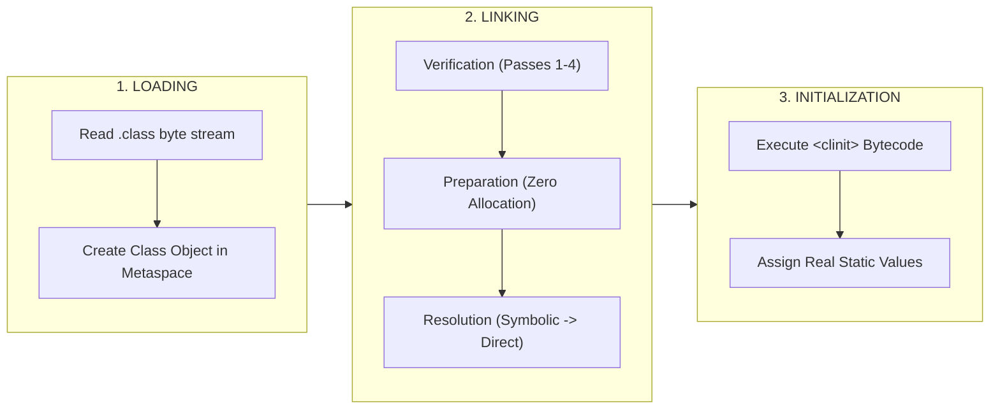
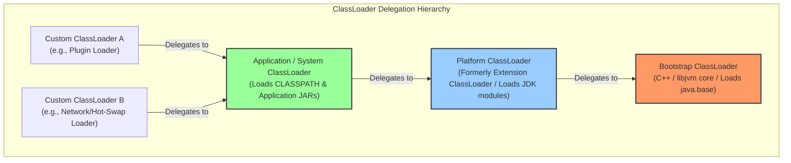

# 02. ClassLoader Subsystem & Bytecode Lifecycle

---

## 1. The Class Loading Lifecycle: The 3 Phases & 7 Steps

The ClassLoader Subsystem is the gatekeeper of the JVM. Its purpose is to locate binary `.class` streams (from disk, network, or dynamic in-memory generation) and convert them into live, executable `java.lang.Class<?>` instances resident in Metaspace.



---

## 2. Phase 1: Loading

Loading is the physical acquisition of raw binary byte arrays conforming to the **Java Class File Format** (beginning with the magic number `0xCAFEBABE`).

### What Happens During Loading:
1. The ClassLoader obtains a byte stream using a fully qualified class name (e.g., `com/example/PaymentService.class`).
2. The byte stream is parsed into an internal C++ data structure called `InstanceKlass` inside HotSpot's **Metaspace**.
3. A mirror instance of type `java.lang.Class` is created in the **Java Heap** so that Java reflection and user code can interact with the class metadata.

---

## 3. Phase 2: Linking (The 3 Sub-Steps)

Linking integrates the loaded binary class representation into the runtime state of the JVM.

### Sub-Step A: Verification (Security & Integrity)
Verification guarantees that the loaded bytecode is structurally sound, safe to execute, and cannot subvert JVM memory safety or execute illegal CPU instructions. It is executed in **Four Rigorous Passes**:

```
+----------------------------------------------------------------------------------------------------+
|                                    THE FOUR VERIFICATION PASSES                                    |
|                                                                                                    |
|  Pass 1: File Format Integrity                                                                     |
|  - Validates magic number is 0xCAFEBABE.                                                           |
|  - Validates Major/Minor version matches the current JVM capability (e.g., v65 for Java 21).       |
|  - Ensures constant pool count matches parsed entries without truncated buffers.                   |
|                                                                                                    |
|  Pass 2: Metadata & Semantic Verification (No Bytecode Execution)                                  |
|  - Every class (except Object) must have a valid superclass.                                       |
|  - Final classes cannot be subclassed; final methods cannot be overridden.                         |
|  - Abstract classes must declare valid method signatures.                                          |
|                                                                                                    |
|  Pass 3: Bytecode Verification (Data Flow & Type Safety)                                           |
|  - Validates operand stack depth never overflows or underflows stack limits at any instruction.     |
|  - Validates local variable types match instruction signatures (e.g., cannot iadd two references). |
|  - Modern Java (Java 6+) uses StackMapTable attributes to verify type safety in linear O(N) time.  |
|                                                                                                    |
|  Pass 4: Symbol Reference Verification                                                             |
|  - Validates that target fields, classes, and methods referenced by name actually exist.           |
|  - Checks access modifiers (public, protected, private, package-private) against caller.           |
+----------------------------------------------------------------------------------------------------+
```

> [!NOTE]
> **StackMapTable Optimization:** In Java 5 and earlier, Pass 3 required complex dataflow analysis (evaluating all branch permutations), slowing down JVM startup. Java 6+ introduced the `StackMapTable` attribute: `javac` computes stack frame types at compile time and records them in the class file, allowing the JVM to verify bytecode via simple linear-time type checks.

---

### Sub-Step B: Preparation (Default Memory Allocation)
During preparation, the JVM allocates native memory in Metaspace for all `static` fields and initializes them to their **default zero values** (not user-defined values yet!).

```java
public class ConfigHolder {
    public static int maxConnections = 500;
    public static final String ENV = "PRODUCTION";
}
```

*During Preparation:*
- `maxConnections` is initialized to **`0`** (NOT `500`).
- *Exception:* Constant primitive and String fields with a `ConstantValue` attribute (such as `static final String ENV = "PRODUCTION"`) are assigned their actual value during preparation because they are compile-time constants stored directly in the constant pool.

---

### Sub-Step C: Resolution (Symbolic to Direct References)
In the compiled `.class` file, references to other classes, methods, and fields are purely symbolic strings (e.g., `"java/lang/String"`, `"println:(Ljava/lang/String;)V"`).
Resolution replaces these symbolic descriptors in the Runtime Constant Pool with **direct memory pointers**:
- Pointer to method code in the V-Table (Virtual Method Table).
- Specific byte offset within the object layout for a field.
- *Timing:* Resolution can be **Eager** (resolved when the class is linked) or **Lazy** (resolved when the instruction referencing the symbol is first executed). HotSpot defaults to lazy resolution.

---

## 4. Phase 3: Initialization (`<clinit>` vs `<init>`)

Initialization is the execution of class-level initialization code.

```
       +---------------------------------------------------------------+
       |             <clinit>            vs           <init>           |
       +---------------------------------+-----------------------------+
       | Class Initializer               | Instance Constructor        |
       | Generated once per class        | Generated per constructor   |
       | Runs when Class is first used   | Runs on 'new' invocation    |
       | Initializes static fields       | Initializes instance fields |
       | Thread-safe & synchronized by VM| Not automatically locked    |
       +---------------------------------+-----------------------------+
```

### The Generation of `<clinit>`
The Java compiler collects all `static` field initializers and `static { ... }` blocks in lexical order and bundles them into an internal, parameterless bytecode method named `<clinit>`:

```java
public class DatabasePool {
    public static int poolSize = 10;
    static {
        poolSize = 25;
        System.out.println("[<clinit>] DatabasePool initialized");
    }
}
```

### Trigger Conditions for Class Initialization (JLS §12.4.1)
A class is initialized *strictly* upon its first active use:
1. Executing the `new` opcode (e.g., `new DatabasePool()`).
2. Accessing a non-constant static field (getstatic / putstatic).
3. Invoking a static method (invokestatic).
4. Invoking reflection on the class (`Class.forName("DatabasePool")`).
5. Initializing a direct subclass (superclasses are initialized first).
6. Being designated as the application's entrypoint class containing `main()`.

> [!IMPORTANT]
> **Thread-Safety of `<clinit>`:** The JVM guarantees that `<clinit>` is executed synchronously under an internal initialization lock. If thread A is executing `<clinit>` and thread B attempts to use the class, thread B blocks until thread A completes. This is the underlying mechanical guarantee that makes the **Initialization-on-demand holder idiom** (Bill Pugh Singleton) 100% thread-safe without explicit `synchronized` keywords!

---

## 5. The ClassLoader Hierarchy & Delegation Model

HotSpot structures ClassLoaders into a strictly ordered parent-child delegation hierarchy:



### The Delegation Algorithm
When `loadClass(String name, boolean resolve)` is invoked, it follows this strict four-step workflow:
```java
protected Class<?> loadClass(String name, boolean resolve) throws ClassNotFoundException {
    synchronized (getClassLoadingLock(name)) {
        // 1. Check if class has ALREADY been loaded by THIS classloader cache
        Class<?> c = findLoadedClass(name);
        if (c == null) {
            try {
                // 2. Delegate up to parent ClassLoader
                if (parent != null) {
                    c = parent.loadClass(name, false);
                } else {
                    // 3. If parent is null, delegate to Bootstrap ClassLoader
                    c = findBootstrapClassOrNull(name);
                }
            } catch (ClassNotFoundException e) {
                // Parent could not find the class; fallback to self
            }

            if (c == null) {
                // 4. Find class in own repository (URL / disk / network bytes)
                c = findClass(name);
            }
        }
        if (resolve) {
            resolveClass(c);
        }
        return c;
    }
}
```

### Architectural Rationale for Parent Delegation
1. **Security & Sandbox Integrity:** Prevents malicious code from masquerading as system classes. If a rogue library bundles a malicious `java.lang.String` or `java.lang.System`, the Application ClassLoader delegates up to the Bootstrap ClassLoader, which loads the authentic JDK implementation. The rogue class is ignored.
2. **Type Uniqueness:** In the JVM, a class's identity is determined by the tuple:
   $$\text{Class Identity} = \langle \text{ClassLoader Instance}, \text{Fully Qualified Class Name} \rangle$$
   Delegation ensures that standard library classes are loaded exactly once across the JVM, preventing `ClassCastException` between identical class names.

---

## 6. Breaking Parent Delegation: Industry Architectural Patterns

While parent delegation is the default, mission-critical enterprise systems deliberately break it:

```
+----------------------------------------------------------------------------------------------------+
|                                 BREAKING PARENT DELEGATION PATTERNS                                 |
|                                                                                                    |
|  1. Web Application Containers (Tomcat, Jetty) - Child-First / Parent-Last                         |
|     - Problem: App A needs Spring 5; App B needs Spring 6. Shared System ClassLoader cannot satisfy  |
|       both simultaneously.                                                                         |
|     - Architecture: WebAppClassLoader overrides loadClass(). It searches local /WEB-INF/lib FIRST. |
|       Only if missing does it delegate to the server parent loader. (java.* classes still delegate).|
|                                                                                                    |
|  2. Thread Context ClassLoaders (TCCL) - Inversion of Control for SPI                              |
|     - Problem: Core Java library (java.sql in Bootstrap loader) needs to load a database driver     |
|       (com.mysql.cj.jdbc.Driver in Application loader). Delegation cannot go downwards!           |
|     - Architecture: DriverManager calls Thread.currentThread().getContextClassLoader() to bridge  |
|       the gap and load vendor drivers from the application context.                                 |
|                                                                                                    |
|  3. OSGi & Modular Plugin Frameworks - Graph-Based Class Loading                                   |
|     - Architecture: Replaces linear hierarchy with a peer-to-peer dependency mesh. ClassLoaders   |
|       delegate across bundles based on explicit Export-Package and Import-Package manifests.       |
+----------------------------------------------------------------------------------------------------+
```

---

## 7. Class Unloading & Metaspace Leaks

A class is not immortal. It can be garbage collected and unlinked from Metaspace only when **all three conditions** are met:
1. Zero instances of the class exist on the Java heap.
2. The `java.lang.Class` mirror object is unreachable by GC roots.
3. The `ClassLoader` that loaded the class is itself completely unreachable by GC roots.

> [!WARNING]
> **The Classic ThreadLocal Metaspace Leak:**
> Classes loaded by the Bootstrap or Application ClassLoaders are **never unloaded** because their ClassLoader is permanently reachable.
> Metaspace memory leaks occur when a dynamic ClassLoader (e.g., Tomcat webapp, CGLIB proxy generator, Groovy script evaluator) creates thousands of transient classes, but a long-lived thread (like a pooled Tomcat executor thread) retains a `ThreadLocal` reference pointing to an object whose class was loaded by that custom ClassLoader. The ClassLoader cannot be collected, pinning all its loaded classes in Metaspace until `java.lang.OutOfMemoryError: Metaspace` crashes the JVM!
