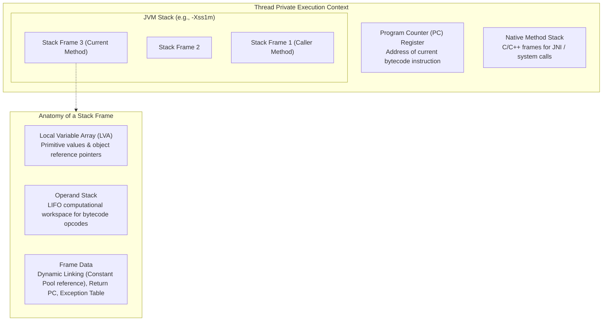

# 03. JVM Memory Model & Runtime Data Areas

---

## 1. The Global HotSpot Memory Architecture

When the operating system spawns the JVM process, it partitions virtual memory into distinct functional regions:

```
+----------------------------------------------------------------------------------------------------+
|                                    TOTAL JVM PROCESS MEMORY                                        |
|                                                                                                    |
|  +-------------------------------------------------------------+  +-----------------------------+  |
|  |                    MANAGED JAVA HEAP                        |  |       CODE CACHE (JIT)      |  |
|  |  +-----------------------------------+ +-----------------+  |  | JIT-compiled native machine |  |
|  |  |       YOUNG GENERATION            | | OLD GENERATION  |  |  | assembly instructions       |  |
|  |  |  [Eden Space]   [S0]   [S1]       | | (Tenured Space) |  |  | (ReservedCodeCacheSize)     |  |
|  |  |  (TLABs: Per-thread alloc buffers)| | Long-lived data |  |  +-----------------------------+  |
|  |  +-----------------------------------+ +-----------------+  |  +-----------------------------+  |
|  +-------------------------------------------------------------+  |          METASPACE          |  |
|                                                                   | Native memory for class     |  |
|  +-------------------------------------------------------------+  | metadata, constant pools,   |  |
|  |                    OFF-HEAP / DIRECT MEMORY                 |  | and method bytecode         |  |
|  |  - Direct ByteBuffers (allocateDirect / Netty zero-copy)    |  +-----------------------------+  |
|  |  - Panama FFM Arena & MemorySegments                        |  +-----------------------------+  |
|  |  - JNI Native Allocations (malloc/free)                     |  |     GC METADATA & TABLES    |  |
|  +-------------------------------------------------------------+  | Card Tables, Remembered     |  |
|                                                                   | Sets, Mark Bitmaps, ZGC Ptrs|  |
|  +-------------------------------------------------------------+  +-----------------------------+  |
|  |              PER-THREAD RUNTIME STACKS                      |                                   |
|  |  Thread 1 Stack | Thread 2 Stack | Thread N Stack (-Xss1m)  |                                   |
|  |  (Frames: Local Var Array, Operand Stack, Dynamic Linking)  |                                   |
|  |  Thread PC Register | Native Method Stack                   |                                   |
|  +-------------------------------------------------------------+                                   |
+----------------------------------------------------------------------------------------------------+
```

---

## 2. Per-Thread Private Memory Areas

Every Java thread possesses its own private execution context. These areas are created when the thread spawns and destroyed when the thread terminates.



### 1. Program Counter (PC) Register
A tiny, hardware-adjacent memory pointer tracking the address of the currently executing JVM bytecode instruction. If the thread is executing a native C/C++ method via JNI, the PC register is undefined (`null`).

### 2. Native Method Stack
Stores execution state for native methods (written in C, C++, or Rust) invoked via JNI or the Panama Foreign Function API.

### 3. JVM Stack & Stack Frame Internals
The JVM Stack is composed of **Stack Frames**. A new frame is pushed onto the stack whenever a method is invoked, and popped when the method returns (either via a return instruction or an uncaught exception).

#### Anatomy of a Single Stack Frame:
1. **Local Variable Array (LVA):**
   - An indexed array storing method arguments and local variables.
   - Sized at compile time (`max_locals` in classfile).
   - Variables are stored in **Slots** (32 bits wide).
     - Primitives (`int`, `float`, `boolean`, `byte`, `short`, `char`) and reference pointers occupy **1 slot**.
     - 64-bit primitives (`long`, `double`) occupy **2 contiguous slots**.
   - For instance methods, slot `0` always contains `this`.
2. **Operand Stack:**
   - A Last-In-First-Out (LIFO) stack used as the computational workspace. Bytecode instructions push operands onto the stack, pop them off, perform calculations, and push the result back.
   - Sized at compile time (`max_stack`).
3. **Dynamic Linking & Frame Data:**
   - Contains a pointer to the **Runtime Constant Pool** of the method's class.
   - Enables symbolic method names to be resolved into direct memory addresses at runtime (late binding).
   - Contains normal method completion info (return value handling) and an **Exception Dispatch Table** mapping bytecode offset ranges to catch blocks.

> [!NOTE]
> **Stack Errors in Production:**
> - `java.lang.StackOverflowError`: Method recursion depth exceeds the thread's stack capacity configured by `-Xss` (default 1MB).
> - `java.lang.OutOfMemoryError: unable to create native thread`: The OS kernel refuses to allocate virtual memory for a new thread stack because physical RAM or OS `max user processes` (`ulimit -u`) limits were reached.

---

## 3. The Java Heap: Generations & Allocation Path

The Heap is the shared memory universe where all class instances and arrays reside.

```
+----------------------------------------------------------------------------------------------------+
|                                      MANAGED JAVA HEAP                                             |
|                                                                                                    |
|  +-------------------------------------------------------------+  +-----------------------------+  |
|  |                       YOUNG GENERATION                      |  |       OLD GENERATION        |  |
|  |  +------------------------------+  +----------+  +----------+  |  |       (TENURED SPACE)       |  |
|  |  |         EDEN SPACE           |  | SURVIVOR |  | SURVIVOR |  |  |                             |  |
|  |  |  +------------------------+  |  | S0 (FROM)|  | S1 (TO)  |  |  | Long-lived objects promoted  |  |
|  |  |  | TLAB (Thread 1)        |  |  +----------+  +----------+  |  | after surviving multiple     |  |
|  |  |  | TLAB (Thread 2)        |  |                              |  | GC cycles.                   |  |
|  |  |  | TLAB (Thread N)        |  | Objects copied between S0/S1 |  | Large objects directly       |  |
|  |  |  +------------------------+  | during Minor GC.             |  | allocated if exceeding       |  |
|  |  | Fast bump-the-pointer alloc  | Aging threshold: 1 -> 15.    |  | PretenureSizeThreshold.     |  |
|  |  +------------------------------+                              |  |                             |  |
|  +-------------------------------------------------------------+  +-----------------------------+  |
+----------------------------------------------------------------------------------------------------+
```

### The Object Allocation Flow:
1. **Thread-Local Allocation Buffer (TLAB):** To avoid global lock contention on the heap pointer, HotSpot assigns each thread a private allocation buffer inside Eden. Allocation in a TLAB is a simple $O(1)$ CPU pointer increment (**Bump-the-Pointer**), requiring zero locking!
2. **Eden Space:** If an object is too large for the thread's TLAB, it is allocated directly in shared Eden space using an atomic CAS (Compare-And-Swap) lock.
3. **Minor GC & Survivor Spaces:** When Eden fills up, a Minor GC triggers:
   - Surviving objects are evacuated to the empty Survivor space (e.g., S0).
   - Eden and the other Survivor space (S1) are wiped clean.
   - Object age counter in the Mark Word is incremented by 1.
4. **Promotion to Old Generation (Tenured):** An object is promoted to the Old Generation when:
   - Its age reaches the **Tenuring Threshold** (configured via `-XX:MaxTenuringThreshold=15`, default typically dynamically adjusted between 1 and 15 by ergonomics).
   - Or Survivor space reaches the **Target Survivor Ratio** (Dynamic Age Calculation: if the cumulative size of objects of age $N$ exceeds 50% of Survivor space, all objects aged $\ge N$ are promoted immediately).

---

## 4. Object Memory Anatomy on 64-bit JVM

Every object allocated on the Java heap has a precise physical memory footprint composed of three parts:

```
+---------------------------------------------------------------------------------------------+
|                                  PHYSICAL JAVA OBJECT LAYOUT                                |
|                                                                                             |
|  +---------------------------------------------------------------------------------------+  |
|  |                                  OBJECT HEADER                                        |  |
|  |  +-------------------------------------------------+  +----------------------------+  |  |
|  |  |                   MARK WORD                     |  |         KLASS WORD         |  |  |
|  |  |  (64 bits / 8 bytes)                            |  |  (32 bits with +UseComp... |  |  |
|  |  |  - HashCode (Identity Hash)                     |  |   64 bits without)         |  |  |
|  |  |  - GC Age (4 bits: 0-15)                        |  |  Pointer to class metadata |  |  |
|  |  |  - Lock State Bits (00, 01, 10, 11)             |  |  in Metaspace              |  |  |
|  |  |  - Biased Lock Flag (deprecated/removed)        |  |                            |  |  |
|  |  +-------------------------------------------------+  +----------------------------+  |  |
|  |  +---------------------------------------------------------------------------------+  |  |
|  |  |                       ARRAY LENGTH (Only present for Arrays)                    |  |  |
|  |  |                       (32 bits / 4 bytes)                                       |  |  |
|  |  +---------------------------------------------------------------------------------+  |  |
|  +---------------------------------------------------------------------------------------+  |
|                                                                                             |
|  +---------------------------------------------------------------------------------------+  |
|  |                                  INSTANCE DATA                                        |  |
|  |  Primitive fields (int, long, byte) and object references packed for cache alignment. |  |
|  +---------------------------------------------------------------------------------------+  |
|                                                                                             |
|  +---------------------------------------------------------------------------------------+  |
|  |                                ALIGNMENT PADDING                                      |  |
|  |  Zero-filled bytes added to make total object size a multiple of 8 bytes (64 bits).    |  |
|  +---------------------------------------------------------------------------------------+  |
+---------------------------------------------------------------------------------------------+
```

### The 64-bit Mark Word Breakdown

The lowest 2 or 3 bits of the Mark Word determine how the remaining 61-62 bits are interpreted:

| Lock State | Bits [63:3] | Biased Flag [2] | Lock Bits [1:0] | Description |
| :--- | :--- | :---: | :---: | :--- |
| **Unlocked** | HashCode (31 bits) \| Unused (25) \| Age (4 bits) | `0` | `01` | Normal unowned object |
| **Lightweight Locked** | Pointer to Displaced Mark Word on Thread Stack | `0` | `00` | CAS lock without OS mutex |
| **Heavyweight Locked** | Pointer to native C++ `ObjectMonitor` instance | `0` | `10` | Full OS mutex contention |
| **Marked for GC** | Pointer to forwarding address / CMS mark bits | `0` | `11` | Used during GC compaction |

---

## 5. Compressed OOPs & The 32 GB Heap Cliff

### What is an OOP?
In HotSpot terminology, an **OOP** is an **Ordinary Object Pointer** (a 64-bit machine pointer referencing a heap memory address).

### The Problem on 64-bit Architectures:
On 64-bit hardware, all pointer references require 8 bytes instead of 4 bytes. This consumes **~40% more memory** for identical data structures and exhausts CPU L1/L2/L3 caches with pointer bloat.

### The Mathematical Solution: Compressed OOPs (`-XX:+UseCompressedOops`)
HotSpot observes that all Java objects are **8-byte aligned** (their memory addresses always end in `000` in binary).
Instead of storing the exact byte address, HotSpot stores the **object index** (shifted right by 3 bits):

$$\text{Physical Byte Address} = \text{Compressed Pointer Value} \ll 3$$

Because $2^{32} \times 8 \text{ bytes} = 32 \text{ Gigabytes}$, **a 32-bit compressed pointer can address up to 32 GB of physical RAM!**

### The 32 GB Cliff (The Architect's Trap)
If an architect increases heap from `-Xmx31g` to `-Xmx32g`:
1. The heap exceeds $32 \text{ GB}$.
2. Compressed OOPs are disabled automatically (`-XX:-UseCompressedOops`).
3. All object references expand from **4 bytes to 8 bytes**.
4. The application immediately suffers a **~20% to ~30% loss of effective heap capacity**!
5. **Rule of Thumb:** A 31 GB heap typically holds *more actual data* than a 33 GB or 34 GB heap!

---

## 6. Metaspace Internals (Post-Java 8)

In Java 7 and earlier, class metadata was stored in the **PermGen (Permanent Generation)** inside the contiguous Java Heap.
PermGen suffered from fatal flaws:
- Fixed maximum size (`-XX:MaxPermSize`). Frequent `java.lang.OutOfMemoryError: PermGen space`.
- Difficult to size; triggered Full Stop-The-World GCs whenever resizing occurred.
- Unloaded classes poorly due to complex heap fragmentation.

### Metaspace Architecture (Java 8 to 25+)
Metaspace replaces PermGen. It lives entirely in **Native Virtual Memory** outside the Java heap.
- Expands dynamically up to total available operating system RAM unless capped via `-XX:MaxMetaspaceSize`.
- Separated into **Compressed Class Space** (for 32-bit class pointers) and **Non-Class Metaspace** (for constant pools, method bytecode, annotations, and JIT metadata).
- Allocation uses **Metachunks** (chunks of native memory allocated per ClassLoader). When a ClassLoader is unreferenced and collected, its Metachunks are returned to the OS or free list.
