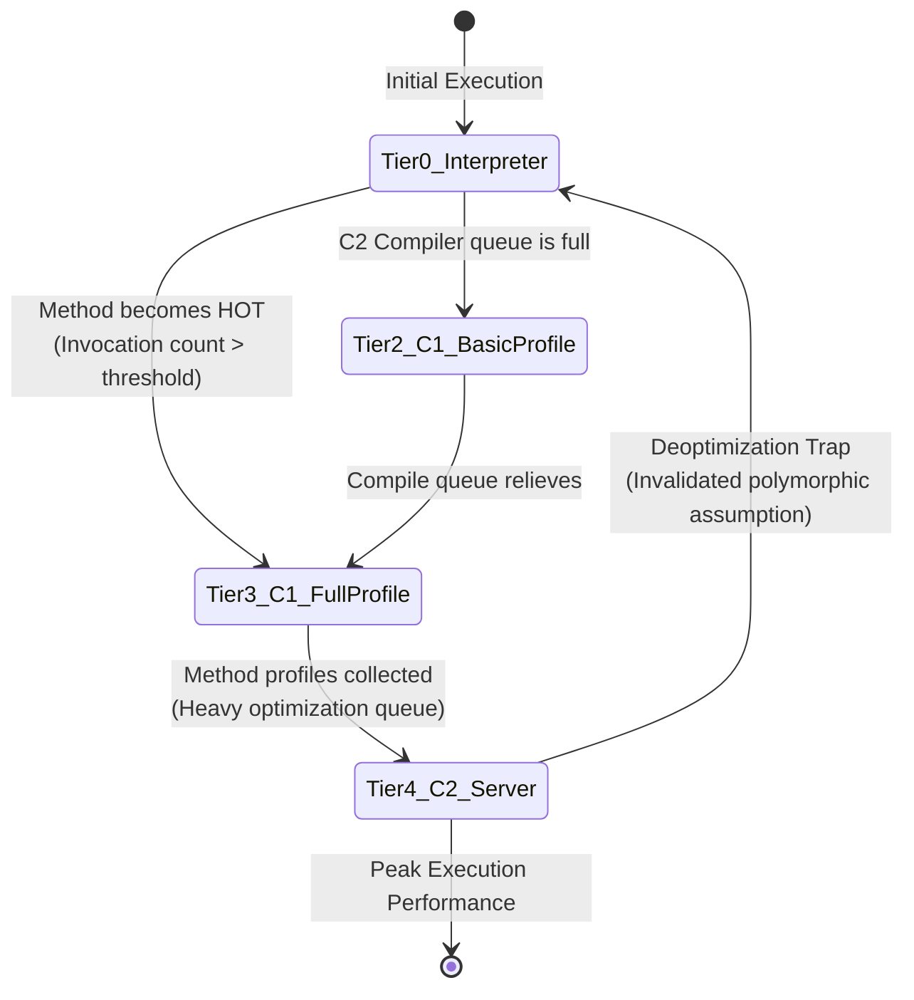

# 04. Execution Engine, JIT Compilation & Optimization

---

## 1. The Hybrid Execution Paradigm

A primary reason for Java's performance is HotSpot's **Hybrid Execution Engine**, which balances **instant startup** via interpretation with **near-C++ peak throughput** via dynamic Just-In-Time (JIT) compilation.

```
       +-------------------------------------------------------------+
       |                     Java Bytecode (.class)                  |
       +-------------------------------------------------------------+
                                      |
                                      v
       +-------------------------------------------------------------+
       |             Tier 0: Template Interpreter                    |
       |  - Zero startup latency; executes bytecodes immediately.    |
       |  - Tracks method invocation and loop backedge counters.     |
       +-------------------------------------------------------------+
                                      |
                   (Method becomes HOT: threshold exceeded)
                                      |
                                      v
       +-------------------------------------------------------------+
       |       Tier 1 to 3: C1 Client Compiler (Intermediate JIT)    |
       |  - Compiles quickly to native machine code.                 |
       |  - Injects profiling instrumentation (MethodDataObjects).   |
       +-------------------------------------------------------------+
                                      |
                   (Method remains intensely HOT & profiled)
                                      |
                                      v
       +-------------------------------------------------------------+
       |          Tier 4: C2 Server Compiler (Opto JIT)              |
       |  - Deep, aggressive speculative optimizations.              |
       |  - Inlining, Escape Analysis, Loop Unrolling, Vectorization.|
       +-------------------------------------------------------------+
                                      |
       +------------------------------+------------------------------+
       |                                                             |
       v (Optimistic assumption holds)                              v (Assumption invalidated)
+-------------------------------+                         +-------------------------------+
|  Peak Native Assembly Speed   |                         |  Deoptimization Bailout       |
|  (Direct x86-64 / ARM64 code) |                         |  (On-Stack Replacement / OSR) |
+-------------------------------+                         |  Drop back to Interpreter     |
                                                          +-------------------------------+
```

---

## 2. Tiered Compilation State Machine

Since Java 7/8, HotSpot activates **Tiered Compilation** (`-XX:+TieredCompilation`) by default. Execution transitions across 5 distinct levels:



### The 5 Tiers Defined:
- **Tier 0 (Interpreter):** Bytecode instructions are mapped directly to pre-generated native assembly templates. Every method invocation and loop backedge increments an internal profiling counter.
- **Tier 1 (Simple C1):** Compiles bytecode into native machine code with zero profiling overhead. Used for trivial methods (getters/setters) that cannot benefit from deep profiling.
- **Tier 2 (Limited C1 Profiling):** Compiles code with basic invocation/backedge counters when the C2 compiler queue is backed up.
- **Tier 3 (Full C1 Profiling):** Compiles code and instruments it with **MDO (MethodDataObjects)** to record branch probabilities, nullness checks, and runtime receiver types at polymorphic call sites.
- **Tier 4 (C2 Server Compiler / Opto):** The heavy-duty optimizing compiler. Analyzes profile data gathered by Tier 3, constructs a High-Level Intermediate Representation (Sea-of-Nodes Graph), and applies deep speculative optimizations.

---

## 3. High-Impact JIT Optimizations Deep Dive

### 1. Method Inlining (The Mother of All Optimizations)
Method call invocation incurs CPU overhead: pushing parameters onto the stack frame, allocating a new stack frame, branching to the target memory address, and jumping back.
**Inlining replaces a method call site with the actual body of the callee method.**

```java
// BEFORE INLINING:
public int calculateTotal(int price) {
    return addTax(price);
}
private int addTax(int val) {
    return val + (int)(val * 0.18);
}

// AFTER C2 INLINING:
public int calculateTotal(int price) {
    return price + (int)(price * 0.18); // Method call eliminated!
}
```

#### Why Inlining is Critical:
Inlining is not just about avoiding call overhead; **inlining unlocks all other optimizations** (dead code elimination, constant propagation, and escape analysis across method boundaries).

#### Inlining Heuristics:
- Trivial methods ($\le 35$ bytes of bytecode) are inlined aggressively (`-XX:MaxInlineSize=35`).
- Frequently executed hot methods ($\le 325$ bytes of bytecode) are inlined if call depth allows (`-XX:FreqInlineSize=325`).

#### Polymorphic Inlining & Inline Caches:
When invoking an interface or abstract method (`invokevirtual` / `invokeinterface`), the target class could theoretically vary:
- **Monomorphic Call Site (1 receiver type observed):** JIT devirtualizes the call and inlines the exact target method directly, protected by a tiny optimistic class-check guard.
- **Bimorphic Call Site (2 receiver types observed):** JIT generates a conditional branch: `if (type == A) inline A(); else inline B();`.
- **Megamorphic Call Site ($\ge 3$ receiver types):** Optimization bails out! JIT falls back to standard, slow V-Table (Virtual Method Table) indirect memory lookups.

---

### 2. Escape Analysis (EA) & Scalar Replacement

Escape Analysis (JSR-133 / HotSpot C2) analyzes the scope of an object's reference. Can the object be accessed outside the current thread or method?

```
                                  ESCAPE ANALYSIS SCOPES
                                  
  +---------------------------------------------------------------------------------+
  | 1. GlobalEscape:                                                                |
  |    The object escapes the method and thread entirely (stored in static field,   |
  |    returned from method, or passed to an external shared data structure).      |
  |    -> MUST BE ALLOCATED ON JAVA HEAP! GC will manage it.                        |
  +---------------------------------------------------------------------------------+
                                           |
                                           v
  +---------------------------------------------------------------------------------+
  | 2. ArgEscape:                                                                   |
  |    The object is passed as an argument to another method, but does not escape   |
  |    the thread.                                                                  |
  |    -> Can benefit from Lock Elision, but cannot be easily scalar-replaced.      |
  +---------------------------------------------------------------------------------+
                                           |
                                           v
  +---------------------------------------------------------------------------------+
  | 3. NoEscape:                                                                    |
  |    The object NEVER escapes the allocating method!                              |
  |    -> CANDIDATE FOR SCALAR REPLACEMENT & LOCK ELISION!                          |
  +---------------------------------------------------------------------------------+
```

#### Optimization A: Scalar Replacement
If an object has `NoEscape`, **HotSpot does not allocate the object on the heap at all!**
Instead, the JIT deconstructs the object into its individual primitive fields (scalars) and maps them directly to **CPU registers** or stack variables:

```java
// BEFORE ESCAPE ANALYSIS:
public int computeDistance() {
    Point p = new Point(10, 20); // Point object allocated on heap?
    return p.x + p.y;
}

// AFTER C2 SCALAR REPLACEMENT:
public int computeDistance() {
    int x = 10; // Placed directly into CPU Register EAX
    int y = 20; // Placed directly into CPU Register EBX
    return x + y; // 0 heap allocations, 0 GC impact, executes in sub-nanosecond!
}
```

> [!NOTE]
> **Why Doesn't Java Just Do Stack Allocation?**
> True stack allocation (like C++ `Point p;`) requires managing complex variable-sized object frames on the stack, which complicates stack unwinding and GC stack-walking during safepoints. Scalar replacement is superior: it completely annihilates the object header, memory pointers, and alignment padding, placing values directly into silicon CPU registers!

#### Optimization B: Lock Elision
If an object does not escape the current thread, synchronization on that object is a no-op. The JIT compiler strips out the `monitorenter` and `monitorexit` instructions entirely:

```java
public String getSafeString() {
    // StringBuffer methods are synchronized.
    // However, sb never escapes this method:
    StringBuffer sb = new StringBuffer();
    sb.append("Aashish");
    sb.append(" Ray");
    return sb.toString(); // JIT removes all internal locking locks automatically!
}
```

---

### 3. Loop Optimizations & Vectorization (SIMD)
- **Loop Unrolling:** Replaces $N$ iterations with chunks of iterations (e.g., executing 4 or 8 loop steps sequentially) to eliminate loop branch prediction penalties and counter increments.
- **Auto-Vectorization (Superword Optimization):** Translates sequential loop operations on arrays of `int`, `float`, or `double` into **SIMD (Single Instruction, Multiple Data)** vector instructions (Intel AVX-512 / ARM Neon). One CPU instruction processes 8 or 16 numbers in a single clock cycle!

---

## 4. Deoptimization & On-Stack Replacement (OSR)

### What is Deoptimization?
C2 optimization is **speculative**. It generates native code based on assumptions that are true *right now* (e.g., "Class `PaymentService` currently has only 1 implementation, `StripePayment`").
If a new class (`PaypalPayment`) is dynamically loaded via ClassLoader later:
1. The speculative assumption is broken!
2. HotSpot triggers an **Uncommon Trap**.
3. The compiled native code executes a **Deoptimization Bailout**: the active execution frame is translated back into an interpreter stack frame on the fly, and execution continues smoothly in the interpreter without crashing!

### On-Stack Replacement (OSR)
What happens if a method contains a giant loop that runs 10,000,000 times, but the method was invoked only once?
- Standard JIT triggers on method invocation counters. Here, invocation count is only 1!
- HotSpot's **Backedge Counter** tracks loop iterations.
- When the backedge counter hits the threshold, C2 compiles the loop *while it is actively running*.
- HotSpot executes **On-Stack Replacement (OSR)**: it replaces the running interpreter stack frame with the newly compiled native machine code frame mid-loop!
