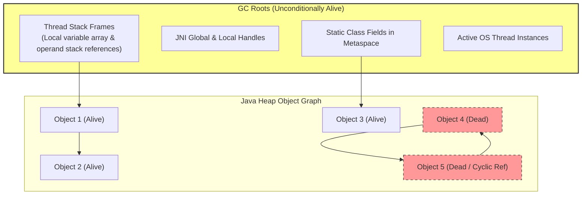
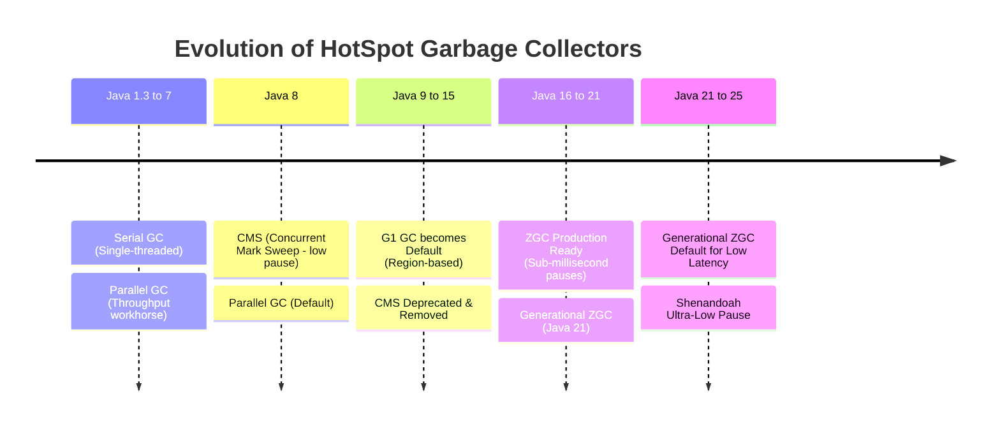
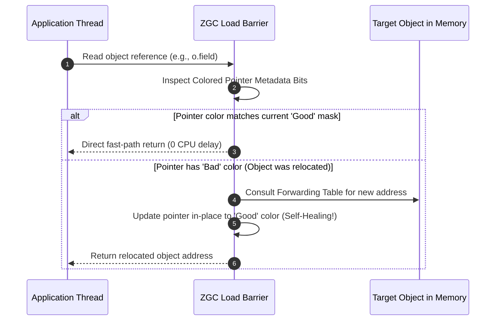

# 05. Garbage Collection Internals & Algorithms

---

## 1. Core Principles of Garbage Collection

Garbage Collection (GC) in the JVM is not merely "freeing unused memory." It is an automated memory subsystem responsible for preserving **referential integrity, eliminating fragmentation, and maintaining cache locality** while minimizing application throughput disruption.

```
       +-------------------------------------------------------------+
       |             The Weak Generational Hypothesis                |
       |                                                             |
       |  1. The overwhelming majority of objects die shortly after  |
       |     allocation (infant mortality > 95%).                    |
       |                                                             |
       |  2. References from older objects to younger objects are    |
       |     exceedingly rare in typical enterprise software.        |
       +-------------------------------------------------------------+
```

---

## 2. GC Roots & Reachability Analysis

Why doesn't the JVM use simple **Reference Counting** (like Python or Swift)?
Because reference counting fails catastrophically on **Cyclic References** (Object A points to Object B, and Object B points to Object A; their count is never 0, causing a permanent memory leak).

Instead, HotSpot employs **Reachability Analysis (Tracing GC)**:



An object is garbage if and only if **no directed path of live references connects any GC Root to that object**.

---

## 3. Card Tables, Remembered Sets & Write Barriers

### The Cross-Generational Problem:
If an object in the **Old Generation** references an object in the **Young Generation (Eden)**, how can a Minor GC collect Eden without scanning the entire, massive Old Generation?
*Scanning the entire Old Gen during every Minor GC would cause catastrophic Stop-The-World pauses!*

### The HotSpot Solution: Card Tables & Write Barriers
HotSpot divides Old Generation memory into contiguous **Cards** of **512 bytes each**.
It maintains a byte array called the **Card Table** where each byte represents one 512-byte card:

```
  Memory:    [ 512 Bytes ] [ 512 Bytes ] [ 512 Bytes ] [ 512 Bytes ]
  CardTable: [   0x00    ] [   0x01    ] [   0x00    ] [   0x00    ]
                             ^ Dirty Card (Contains an Old -> Young reference)
```

#### The Post-Write Barrier:
Whenever JIT-compiled code updates an object reference (`emp.department = newDept`), the compiler injects a tiny native instruction hook called a **Write Barrier**:

```c
// HotSpot C++ Write Barrier Logic injected into assembly:
void post_write_barrier(oop* field_address, oop new_value) {
    size_t card_index = ((size_t)field_address) >> 9; // Divide by 512
    ByteMap[card_index] = DIRTY_BYTE; // Mark card as dirty (0x01)
}
```

During a Minor GC, HotSpot only scans the **Dirty Cards** in the Card Table, reducing root scanning time from hundreds of milliseconds to microseconds!

---

## 4. The Evolution of Modern Garbage Collectors



---

## 5. G1 GC (Garbage-First): The Production Default

G1 partitions the continuous heap into **2,048 equal-sized contiguous memory Regions** (varying from 1MB to 32MB depending on heap size):

```
+----+----+----+----+----+----+----+----+
| E  | E  | S  | O  | O  | H  | E  | Free|
+----+----+----+----+----+----+----+----+
| O  | Free| E | S  | O  | H  | O  | Free|
+----+----+----+----+----+----+----+----+
  E = Eden Region | S = Survivor Region | O = Old Region | H = Humongous Region
```

### Key Architectural Concepts of G1:
1. **Dynamic Region Roles:** Regions are not fixed. A region can be Eden today, collected, and become Old Generation tomorrow.
2. **Humongous Regions:** Objects exceeding 50% of a region size are categorized as *Humongous*, allocated in a contiguous sequence of special regions, and collected aggressively.
3. **Garbage-First Principle:** G1 continuously monitors regions for their reclamation efficiency (garbage ratio). During Mixed GC cycles, G1 prioritizes collecting the regions that contain the highest percentage of garbage first ("Garbage-First").
4. **Pause Time Predictability (`-XX:MaxGCPauseMillis=200`):** G1 models its pause time budget. If a pause target is 100ms, G1 calculates exactly how many regions it can evacuate within that time window.
5. **SATB (Snapshot-At-The-Beginning):** Concurrent marking algorithm that takes a logical snapshot of the object graph at marking start. Uses pre-write barriers to preserve references overwritten during concurrent marking.

---

## 6. ZGC (Z Garbage Collector): Sub-Millisecond Latency

ZGC is a revolutionary, concurrent, scalable low-latency garbage collector designed for heaps ranging from **16 Megabytes to 16 Terabytes**, maintaining **pause times under 1 millisecond**!

```
Traditional GC: Stop-The-World Pause scales with Heap Size (100GB Heap = Seconds of pause!)
ZGC:           Pause Time is Constant (< 1ms) REGARDLESS OF WHETHER HEAP IS 16GB OR 16TB!
```

### The Two Core Inventions of ZGC:

#### 1. Colored Pointers (Reference Metadata Inside 64-Bit Pointers)
ZGC does not store GC metadata in the object header on the heap. Instead, it embeds metadata bits directly inside the **virtual memory address pointer itself**:

```
 64-bit Virtual Address in ZGC:
+-------------------+----------------+-----------------------------------------------+
| 16 Unused Bits    | 4 Metadata Bits| 44-bit Object Offset (Addresses up to 16 TB)  |
| (63 - 48)         | (47 - 44)      | (43 - 0)                                      |
+-------------------+----------------+-----------------------------------------------+
                             |
             +---------------+---------------+
             | Finalizable | Remapped | Marked1 | Marked0 |
```

- **Marked0 / Marked1:** Tracks whether an object is currently determined to be alive.
- **Remapped:** Indicates whether the pointer points directly to the object's current memory location (after concurrent relocation) or requires translation through the forwarding table.

#### 2. Load Barriers & Self-Healing Pointers
In traditional collectors, moving an object during compaction requires freezing all application threads to update every pointer pointing to that object.
**ZGC relocates objects concurrently while application threads run!**



The next time *any* thread reads that same reference, the load barrier takes the fast-path! The pointer has **healed itself**.

---

## 7. GC Architectural Comparison Matrix

| Collector | Target Goal | Typical Pause Time | Scalability (Heap Size) | Algorithmic Mechanism | Production Use Case |
| :--- | :--- | :--- | :--- | :--- | :--- |
| **Serial GC** | Minimal footprint | 100ms - 2s (STW) | Small (< 512MB) | Single-threaded Mark-Copy-Compact | Embedded devices, single-core micro-containers |
| **Parallel GC** | Maximum Throughput | 200ms - 5s (STW) | Moderate (1GB - 32GB) | Multi-threaded STW copying | Offline batch processing, massive ETL, high-compute math |
| **G1 GC** | Balanced Throughput & Latency | 50ms - 250ms | Large (4GB - 64GB) | Region-based, Concurrent SATB, Mixed Collections | **Standard production default** for web microservices |
| **ZGC** | Ultra-Low Latency | **< 1 millisecond** | Massive (16MB - 16TB) | Colored Pointers, Load Barriers, Concurrent Relocation | Real-time financial trading, gaming backends, large cache heaps |
| **Shenandoah** | Ultra-Low Latency | < 10 milliseconds | Large (4GB - 100GB+) | Brooks Pointers / Load-Reference Barriers | Low-latency workloads on platforms where ZGC is unsupported |
