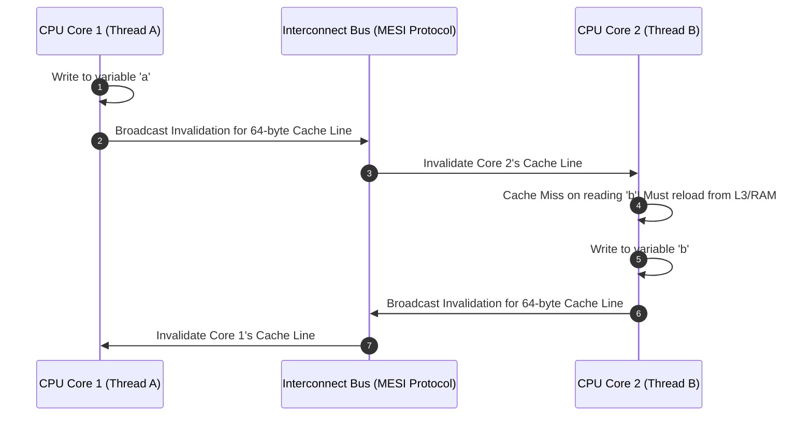
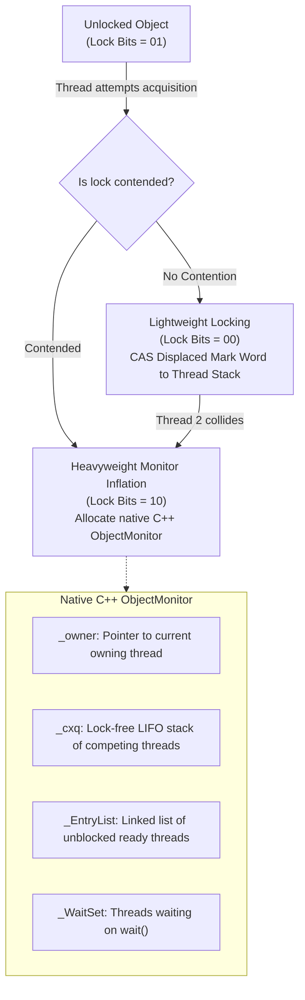
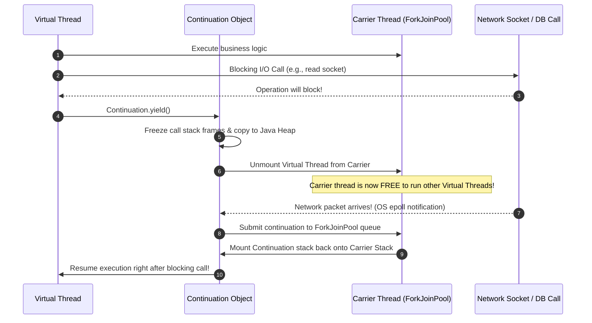

# 06. Java Memory Model (JMM), Concurrency & Virtual Threads

---

## 1. Hardware Architecture vs The Java Memory Model

Modern computers do not execute instructions directly against RAM. A modern multi-core CPU is a distributed caching engine:

```
+----------------------------------------------------------------------------------------------------+
|                                    HARDWARE MEMORY TOPOLOGY                                        |
|                                                                                                    |
|  +------------------------------------+            +------------------------------------+          |
|  |             CPU CORE 1             |            |             CPU CORE 2             |          |
|  |  [Execution Pipeline / Registers]  |            |  [Execution Pipeline / Registers]  |          |
|  |                 |                  |            |                 |                  |          |
|  |          [Store Buffer]            |            |          [Store Buffer]            |          |
|  |                 |                  |            |                 |                  |          |
|  |          [L1 Data Cache (32KB)]    |            |          [L1 Data Cache (32KB)]    |          |
|  |                 |                  |            |                 |                  |          |
|  |          [L2 Cache (512KB)]        |            |          [L2 Cache (512KB)]        |          |
|  +-----------------+------------------+            +-----------------+------------------+          |
|                    |                                                 |                             |
|                    +------------------------+------------------------+                             |
|                                             |                                                      |
|                                             v                                                      |
|                             +-------------------------------+                                      |
|                             |      SHARED L3 CACHE (16MB)   |                                      |
|                             +---------------+---------------+                                      |
|                                             |                                                      |
|                                             v                                                      |
|                             +-------------------------------+                                      |
|                             |      MAIN SYSTEM RAM (64GB)   |                                      |
|                             +-------------------------------+                                      |
+----------------------------------------------------------------------------------------------------+
```

### The Latency Numbers Every Architect Must Memorize:
- **CPU Register Access:** ~1 clock cycle ($\approx 0.3 \text{ ns}$)
- **L1 Cache Hit:** ~4 clock cycles ($\approx 1 \text{ ns}$)
- **L2 Cache Hit:** ~14 clock cycles ($\approx 4 \text{ ns}$)
- **L3 Cache Hit (Shared):** ~50 clock cycles ($\approx 15 \text{ ns}$)
- **Main RAM Access:** ~200 clock cycles ($\approx 60 \text{ ns}$) - **200x slower than L1 cache!**

---

## 2. False Sharing & The 64-Byte Cache Line

CPUs do not load individual bytes from RAM; they load chunks of **64 contiguous bytes** called a **Cache Line**.

### The False Sharing Disaster:
Suppose two threads on Core 1 and Core 2 modify two independent variables `a` and `b`:
```java
public class FalseSharingTarget {
    public volatile long a = 0; // 8 bytes
    public volatile long b = 0; // 8 bytes
}
```
Because `a` and `b` are adjacent in memory, they land inside the **exact same 64-byte cache line**!



Even though `a` and `b` are completely independent logical variables, the cores constantly ping-pong the cache line back and forth across the hardware bus (**Cache Line Bouncing**), causing up to an **800% performance degradation**!

### The Architect's Fix: Cache Line Padding & `@Contended`
Insert 56 bytes of padding or annotate with `@jdk.internal.vm.annotation.Contended` so that variables reside on distinct 64-byte cache lines:
```java
public class PaddedTarget {
    public volatile long a = 0;
    // 56 bytes of padding (7 longs * 8 bytes) to push 'b' into next cache line
    public long p1, p2, p3, p4, p5, p6, p7;
    public volatile long b = 0;
}
```

---

## 3. The Java Memory Model (JMM / JSR-133) & Happens-Before

The JMM defines the legal interactions between threads and memory. Because modern compilers reorder instructions and modern CPUs reorder memory writes in Store Buffers, **the execution order of code is not guaranteed to match program text order unless a Happens-Before relationship exists**.

### The 6 Core Happens-Before Rules:
1. **Program Order Rule:** Each action in a single thread happens-before every action that comes later in program order within that same thread.
2. **Monitor Lock Rule:** An `unlock` on a monitor lock happens-before every subsequent `lock` on that same monitor.
3. **Volatile Variable Rule:** A write to a `volatile` field happens-before every subsequent read of that same `volatile` field.
4. **Thread Start Rule:** A call to `Thread.start()` on a thread happens-before any action in the started thread.
5. **Thread Termination Rule:** Any action in a thread happens-before any other thread successfully detects that it has terminated (via `join()` or `isAlive() == false`).
6. **Transitivity Rule:** If $A \text{ happens-before } B$, and $B \text{ happens-before } C$, then $A \text{ happens-before } C$.

---

## 4. Hardware Memory Barriers (Fences) Under the Hood

To enforce the Happens-Before relationship, the JVM instructs the CPU to insert hardware **Memory Barriers**:

| Barrier Type | Definition | Hardware Action |
| :--- | :--- | :--- |
| **LoadLoad** | Guarantees all preceding reads complete before subsequent reads execute. | Flushes CPU invalidation queues. |
| **StoreStore** | Guarantees all preceding writes are flushed to cache before subsequent writes execute. | Drains CPU store buffers. |
| **LoadStore** | Guarantees all preceding reads complete before subsequent writes execute. | Prevents speculative store bypass. |
| **StoreLoad** | **The Most Expensive Barrier.** Guarantees all preceding writes are visible to all cores before any subsequent reads execute. | Emits `lock addl` or `mfence` on x86-64. |

### What HotSpot Emits for `volatile`:
```
  [StoreStore Barrier]
  WRITE volatile field
  [StoreLoad Barrier]   <-- Emits hardware 'lock addl $0,0(%rsp)' on x86
  READ volatile field
  [LoadLoad Barrier]
  [LoadStore Barrier]
```

> [!WARNING]
> **Why `volatile` is NOT Atomic:**
> `volatile` guarantees **Visibility** (changes are immediately flushed to L3/RAM) and **Ordering** (instructions are not reordered across fences).
> However, `volatile` does **NOT guarantee Atomicity**! An operation like `count++` requires three distinct steps: `READ -> MODIFY -> WRITE`. If two threads read concurrently, both write back the same incremented value! Atomic operations require CAS instructions (`AtomicInteger` / `VarHandle`).

---

## 5. Synchronization & Monitor Inflation Internals

HotSpot manages the `synchronized` keyword through a 3-tier evolutionary locking ladder:



### The Locking Stages:
1. **Lightweight Locking (Thin Lock):**
   - The thread allocates a `BasicObjectLock` on its own JVM Stack.
   - It performs an atomic CPU `CAS` (Compare-And-Swap) to copy the object's Mark Word to its stack (the **Displaced Mark Word**) and update the object's Mark Word to point to the stack frame.
   - If CAS succeeds, the lock is acquired without touching OS kernel synchronization primitives!
2. **Heavyweight Inflation (Fat Lock):**
   - If a second thread attempts acquisition while the lightweight lock is held, CAS fails.
   - HotSpot applies **Adaptive Spinning** (spinning in a tight loop for a few hundred CPU cycles in hopes the owner releases quickly).
   - If spinning fails, HotSpot **inflates the lock**: it allocates a C++ `ObjectMonitor` structure in native memory, sets the Mark Word lock bits to `10`, and parks the competing thread using an OS kernel mutex (`pthread_mutex_lock` / `park()`).

---

## 6. Project Loom & Virtual Threads Internals

Java 21 introduces **Virtual Threads (JEP 444)**, fundamentally decoupling application concurrency from OS kernel thread limits.

```
+----------------------------------------------------------------------------------------------------+
|                                    PLATFORM THREADS VS VIRTUAL THREADS                             |
|                                                                                                    |
|  Platform Thread Model (1:1):                                                                      |
|  Java Thread --------> OS Kernel Thread --------> Physical CPU Core                                |
|  - Expensive: ~1 MB reserved virtual memory stack per thread.                                     |
|  - Context switch requires kernel mode transition (~1,000 to 2,000 ns).                            |
|  - Limits application to ~5,000 - 10,000 concurrent threads before crashing with OOM.              |
|                                                                                                    |
|  Virtual Thread Model (M:N):                                                                       |
|  1,000,000 Virtual Threads (Heap Objects)                                                         |
|        \                                                                                           |
|         v (Scheduled by ForkJoinPool onto)                                                         |
|  Carrier Threads (Platform Threads = Number of CPU Cores) --------> Physical CPU Core            |
|  - Ultra-cheap: ~1 KB initial memory footprint on Java Heap!                                       |
|  - Context switch happens entirely in user-space inside JVM (~50 ns).                              |
|  - Supports millions of simultaneous concurrent threads!                                           |
+----------------------------------------------------------------------------------------------------+
```

### How Virtual Threads Work Under the Hood:



### The Architect's Warning: Thread Pinning!
A virtual thread is **Pinned** to its carrier thread if it blocks inside:
1. A `synchronized` block or method (due to native C++ `ObjectMonitor` tying the lock to the physical OS thread).
2. A native JNI call.

*When pinned, the underlying carrier thread cannot be released to run other virtual threads.*
**Architectural Rule:** In high-concurrency Virtual Thread applications, replace all blocking `synchronized` blocks with **`java.util.concurrent.locks.ReentrantLock`**!
