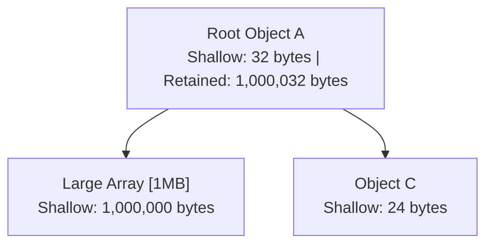

# 08. Architect Troubleshooting, Profiling & Tuning Playbook

---

## 1. The Principal Architect Diagnostic Mindset

When production systems fail under high load, junior engineers randomly toggle JVM flags or restart pods. A Principal Architect diagnoses the JVM through **systematic, deterministic diagnostic procedures** that pinpoint the exact operating system resource or JVM subsystem in distress.

```
       +-------------------------------------------------------------+
       |             The 4 Critical Production Failure Modes         |
       |                                                             |
       |  1. High CPU Utilization (> 90%) with degraded throughput   |
       |  2. OutOfMemoryError (Heap, Metaspace, or Native Threads)   |
       |  3. P99/P999 Latency Spikes (Long GC Pauses & Safepoints)   |
       |  4. Thread Starvation & Systemic Deadlocks                  |
       +-------------------------------------------------------------+
```

---

## 2. Playbook 1: Diagnosing High CPU Under Load

When CPU spikes to 100%, you must correlate the offending **Linux OS Thread ID** directly with the internal **JVM Thread Name and Stack Trace**.

### Step-by-Step Production Procedure:

```bash
# 1. Identify the JVM process ID (PID)
jcmd

# 2. Identify the specific native thread consuming the highest CPU inside the JVM
top -H -p <PID>
# Suppose thread ID 14238 is consuming 98% CPU.

# 3. Convert the decimal thread ID to hexadecimal (lowercase)
printf "%x\n" 14238
# Output: 379e

# 4. Generate a JVM thread dump and grep for the hexadecimal 'nid' (native ID)
jcmd <PID> Thread.print > /tmp/threaddump.tdump
grep -A 30 "nid=0x379e" /tmp/threaddump.tdump
```

### Analyzing the Output:
- **Case A: The thread is a Java Business Thread:** You immediately see the exact class name, method, and source line number spinning in an infinite loop or excessive regex evaluation.
- **Case B: The thread is `VM Thread` or `GC Thread#N`:** The high CPU is **not caused by business logic**! The JVM is trapped in a **GC Thrashing Death Spiral**: heap is 99% full, and GC threads are continuously consuming 100% of all CPU cores attempting to reclaim memory.

---

## 3. Playbook 2: Diagnosing Memory Leaks (`OutOfMemoryError`)

### Shallow Heap vs Retained Heap:
- **Shallow Heap:** The physical memory consumed by the object itself (its header, primitives, and reference pointers).
- **Retained Heap:** The total memory that would be reclaimed if this object were garbage collected (the object itself plus the transitive closure of all objects exclusively reachable through it).



### Procedure to Isolate a Heap Leak:

```bash
# 1. Capture an immediate, non-intrusive live heap dump
jcmd <PID> GC.heap_dump /tmp/production_leak.hprof

# 2. Or configure JVM to automatically dump heap ON CRASH:
# -XX:+HeapDumpOnOutOfMemoryError -XX:HeapDumpPath=/var/log/jvm_dumps/
```

### Analysis with Eclipse Memory Analyzer (MAT):
1. Load `production_leak.hprof` into Eclipse MAT.
2. Open the **Dominator Tree**: lists objects ordered by their **Retained Heap**. In 95% of leaks, the top 1 or 2 rows account for >80% of the entire heap!
3. Right-click the offending dominator node $\rightarrow$ **Path to GC Roots** $\rightarrow$ **Exclude Weak/Soft References**.
4. The remaining strong reference path reveals the rogue cache, unclosed queue, or static collection pinning the objects in memory!

---

## 4. Playbook 3: Safepoint Stalls & Latency Spikes

### What is a Safepoint?
A **Safepoint** is a designated execution point in bytecode where all application threads must pause so that the JVM can perform stop-the-world operations:
- Garbage collection sweeps.
- Deoptimization and class redefinition.
- Biased lock revocation.
- Thread dumps and heap profiling.

### The Safepoint Latency Bug (Counted Loops):
In HotSpot, the JIT compiler inserts **Safepoint Poll Checks** at method exits and uncounted loop backedges.
Historically, HotSpot **omitted safepoint checks inside counted loops** (e.g., `for (int i = 0; i < 1_000_000_000; i++)`) to optimize throughput!
- If Thread 1 is running a long counted loop, and the JVM requests a GC pause, **all other threads pause immediately, but the GC cannot start until Thread 1 finishes its loop!**
- **Symptom:** P99 latency spikes of 500ms without any significant GC collection time!
- **Architect Fix (Java 10+):** `-XX:+UseCountedLoopSafepoints` (or upgrade to Java 21+ where loop safepoints are standard).

```bash
# Diagnostic flags to monitor safepoint pauses in logs:
-XX:+PrintSafepointStatistics -XX:PrintSafepointStatisticsCount=1
```

---

## 5. The Modern Observability Toolkit

```
+---------------------------------------------------------------------------------------------+
|                                    JVM PROFILING TOOLKIT                                    |
|                                                                                             |
|  1. Java Flight Recorder (JFR) & JDK Mission Control (JMC):                                 |
|     - Low-overhead (<1% CPU) built-in kernel event tracker.                                 |
|     - Records CPU, locks, socket I/O, file I/O, GC phases, and thread allocation pressure.  |
|     - Command: jcmd <PID> JFR.start name=prod_profile duration=60s filename=prod.jfr       |
|                                                                                             |
|  2. Async-Profiler (Flamegraphs):                                                           |
|     - Eliminates "Safepoint Bias" (standard sampling profilers only sample at safepoints,    |
|       grossly misrepresenting where CPU time is actually spent).                             |
|     - Uses Linux perf_events and HotSpot AsyncGetCallTrace to generate SVG Flamegraphs.     |
|     - Command: ./profiler.sh -d 30 -f /tmp/flamegraph.svg <PID>                             |
|                                                                                             |
|  3. Native Memory Tracking (NMT):                                                           |
|     - Tracks off-heap memory usage (Metaspace, Thread Stacks, CodeCache, GC structures).    |
|     - Flag: -XX:NativeMemoryTracking=summary                                                |
|     - Command: jcmd <PID> VM.native_memory baseline                                         |
|                jcmd <PID> VM.native_memory detail.diff                                      |
+---------------------------------------------------------------------------------------------+
```

---

## 6. The Production Flag Matrix for High-Scale Systems

### Preset A: High-Throughput Web Microservice (G1 GC Default)
```bash
java \
  -server \
  -Xms4g -Xmx4g \
  -XX:+AlwaysPreTouch \
  -XX:+UseG1GC \
  -XX:MaxGCPauseMillis=200 \
  -XX:InitiatingHeapOccupancyPercent=45 \
  -XX:G1ReservePercent=15 \
  -XX:+UseCompressedOops \
  -XX:+UseCompressedClassPointers \
  -XX:MetaspaceSize=256m \
  -XX:MaxMetaspaceSize=512m \
  -XX:+HeapDumpOnOutOfMemoryError \
  -XX:HeapDumpPath=/var/log/jvm_dumps/ \
  -Djava.security.egd=file:/dev/./urandom \
  -jar app.jar
```

### Preset B: Ultra-Low Latency Service (Generational ZGC / Java 21+)
```bash
java \
  -server \
  -Xms16g -Xmx16g \
  -XX:+AlwaysPreTouch \
  -XX:+UseZGC \
  -XX:+ZGenerational \
  -XX:+UseCompressedOops \
  -XX:+HeapDumpOnOutOfMemoryError \
  -XX:HeapDumpPath=/var/log/jvm_dumps/ \
  -jar trading-service.jar
```

### Architectural Rationale for Key Flags:
- **`-Xms = -Xmx`:** Pre-allocates the entire heap during startup. Eliminates runtime heap expansion and contraction Stop-The-World pauses.
- **`-XX:+AlwaysPreTouch`:** Iterates through every allocated memory page during startup and writes a byte, forcing the OS kernel to map physical RAM pages to virtual address space immediately. Eliminates runtime OS page-fault latency spikes during peak traffic!
- **`-XX:+ZGenerational`:** Activates Generational ZGC in Java 21+, combining sub-millisecond pauses with the Weak Generational Hypothesis for maximum sustained throughput.
