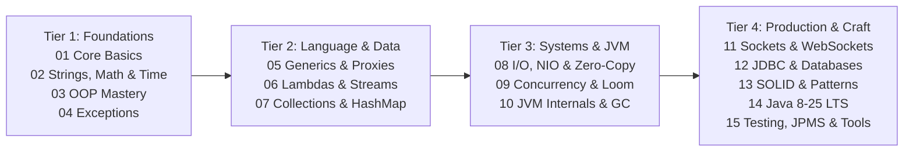

# ☕ Java-Labs — The Complete Noob-to-Senior Java Mastery & Revision Hub

> **One-stop, zero-fluff engineering reference covering Core Java, OOP, Strings/Math/Time, Exceptions, Generics/Reflection, Streams, Collections/`HashMap` Internals, I/O & NIO, Concurrency/JMM/Virtual Threads, JVM Internals/GC, Sockets, JDBC, Design Patterns, Java 8–25 LTS, Testing, and Interview Prep.**

[](14-java-lts-evolution/)
[](#the-3-layer-dual-track-spiral-technique)
[](#complete-15-module-master-curriculum)

---

## 🎯 Why This Repository Exists

Most Java repositories fall into one of two traps:
1. **Too simplistic:** Toy `Animal -> Dog` snippets that never explain *why* `HashMap` treeifies, *why* `volatile` doesn't make `count++` atomic, or *how* `ByteBuffer` zero-copy works.
2. **Too dense:** Wall-of-text internals that overwhelm beginners trying to build clean intuition first.

**`java-labs` solves both** using a research-backed pedagogical architecture combining **Diátaxis**, **Progressive Disclosure**, and **Spiral Learning** — plus a dedicated **Rapid Revision Engine** (`REVISION_CHEATSHEET.md` + per-topic `interview/INTERVIEW_QUESTIONS.md`) so you can revise before an interview in minutes.

---

## 🧠 The 3-Layer Dual-Track Spiral Technique

Every single topic inside `java-labs` is structured so **both a beginner and a Senior/Staff engineer** get immediate value without stepping on each other:

```text
┌─────────────────────────────────────────────────────────────────────────────┐
│  ⚡ 2-MINUTE RAPID REVISION CARD (Top of every topic README + Cheatsheet)     │
│     High-signal numbers, traps, and decision matrices before interviews     │
├─────────────────────────────────────────────────────────────────────────────┤
│  🟢 LAYER 1 — NOOB TRACK ("Mental Model & First Working Code")               │
│     Plain-English analogies, zero jargon, 15-line runnable starter demos    │
├─────────────────────────────────────────────────────────────────────────────┤
│  🟡 LAYER 2 — PRACTITIONER TRACK ("Core Rules, Edge Cases & Patterns")       │
│     Idiomatic APIs, trade-offs, comparison tables, production pitfalls      │
├─────────────────────────────────────────────────────────────────────────────┤
│  🔴 LAYER 3 — SENIOR / ARCHITECT TRACK ("Under the Hood: JVM, OS & Bytecode")│
│     HotSpot Headers, Bytecode (javap), JMM Happens-Before, GC, Syscalls     │
├─────────────────────────────────────────────────────────────────────────────┤
│  🎯 INTERVIEW BANK (Every Topic's interview/INTERVIEW_QUESTIONS.md)          │
│     Beginner -> Intermediate -> Senior -> Tricky Output Puzzles             │
└─────────────────────────────────────────────────────────────────────────────┘
```

### Pick Your Starting Track
- **🟢 New to Java / Fundamentals Refresh:** Start at Module **01 -> 02 -> 03 -> 04 -> 06**, running the `beginner` classes first and reading Layer 1 notes.
- **🟡 Mid-Level Backend Developer:** Focus on **05 (Generics/Proxies), 07 (Collections/HashMap), 08 (NIO.2), 09 (Concurrency/Pools), 12 (JDBC), 13 (Design Patterns), 15 (Testing/Diagnostics)**.
- **🔴 Senior / Staff / Interview Sprint:** Hit **[`REVISION_CHEATSHEET.md`](REVISION_CHEATSHEET.md)**, **[`03-object-oriented-programming/oops-revisit.md`](03-object-oriented-programming/oops-revisit.md)**, **09 (JMM/Loom)**, **10 (JVM Internals/GC/JIT)**, and every module's **`interview/INTERVIEW_QUESTIONS.md`**!

---

## 🗺️ Learning Roadmap



---

## 📚 Complete 15-Module Master Curriculum

Every module contains: **`README.md`** (quick card + run guide), **`notes/`**, **`codes/`**, and **`interview/INTERVIEW_QUESTIONS.md`**.

| # | Module | Key Topics Covered | Notes | Codes | Interview Prep |
|---:|---|---|---|---|---|
| **01** | [**Core Java Foundations**](01-core-java-foundations/) | Variables, 8 Primitives, Stack vs Heap, Wrapper Cache (`-128..127`), Operators, Bitwise, `switch` Expressions, Arrays & Copy Traps | [Notes](01-core-java-foundations/notes/) | [Codes](01-core-java-foundations/codes/) | [Interview Q&A](01-core-java-foundations/interview/INTERVIEW_QUESTIONS.md) |
| **02** | [**Strings, Math & DateTime**](02-strings-math-and-datetime/) | String Pool (`intern()`), Compact Strings, `StringBuilder`, Text Blocks, Regex & ReDoS, `BigDecimal` Traps, `java.time` (JSR-310) | [Notes](02-strings-math-and-datetime/notes/) | [Codes](02-strings-math-and-datetime/codes/) | [Interview Q&A](02-strings-math-and-datetime/interview/INTERVIEW_QUESTIONS.md) |
| **03** | [**Object-Oriented Programming**](03-object-oriented-programming/) | 4 Pillars, Constructors, Access Modifiers, Immutability, Overload Ladder, `vtable` Dispatch, `Object` Contracts, Composition, Nested Classes, Enums, Smart Home Mini-Project + [`oops-revisit.md`](03-object-oriented-programming/oops-revisit.md) | [Notes](03-object-oriented-programming/notes/) | [Codes](03-object-oriented-programming/codes/) | [Interview Q&A](03-object-oriented-programming/interview/INTERVIEW_QUESTIONS.md) |
| **04** | [**Exception Handling**](04-exception-handling/) | `Throwable` Hierarchy, Checked vs Unchecked, JVM Exception Tables, `finally` Return Traps, Try-With-Resources, Suppressed, Stackless Exceptions | [Notes](04-exception-handling/notes/) | [Codes](04-exception-handling/codes/) | [Interview Q&A](04-exception-handling/interview/INTERVIEW_QUESTIONS.md) |
| **05** | [**Generics, Reflection & Annotations**](05-generics-reflection-annotations/) | Invariance, PECS (`? extends` / `? super`), Type Erasure, Bridge Methods, Heap Pollution, Reflection, `MethodHandles`, JDK Dynamic Proxies, Custom Annotations | [Notes](05-generics-reflection-annotations/notes/) | [Codes](05-generics-reflection-annotations/codes/) | [Interview Q&A](05-generics-reflection-annotations/interview/INTERVIEW_QUESTIONS.md) |
| **06** | [**Functional Programming & Streams**](06-functional-programming-and-streams/) | All 43 `java.util.function` Types, Method Refs, `invokedynamic`, Complete `Optional` API, Stream Creation, All Intermediate/Terminal Ops, `Collectors` Mastery, Parallel Pitfalls, Java 25 `Gatherers` | [Notes](06-functional-programming-and-streams/notes/) | [Codes](06-functional-programming-and-streams/codes/) | [Interview Q&A](06-functional-programming-and-streams/interview/INTERVIEW_QUESTIONS.md) |
| **07** | [**Collections & `HashMap` Internals**](07-collections-and-hashmap-internals/) | `ArrayList`, `LinkedList`, `ArrayDeque`, `PriorityQueue`, `TreeMap`, `ConcurrentHashMap`, Custom `MyHashMap` from scratch, Treeification, LRU Cache, Sequenced Collections | [Notes](07-collections-and-hashmap-internals/notes/) | [Codes](07-collections-and-hashmap-internals/codes/) | [Interview Q&A](07-collections-and-hashmap-internals/interview/INTERVIEW_QUESTIONS.md) |
| **08** | [**I/O, NIO, NIO.2 & Serialization**](08-io-nio-and-serialization/) | `Path`/`Files`, Lazy 10GB `Files.lines`, Decorator Streams, `ByteBuffer` State Machine, Direct Off-Heap Buffers, `sendfile` Zero-Copy, `mmap`, Serialization Security | [Notes](08-io-nio-and-serialization/notes/) | [Codes](08-io-nio-and-serialization/codes/) | [Interview Q&A](08-io-nio-and-serialization/interview/INTERVIEW_QUESTIONS.md) |
| **09** | [**Multithreading & Concurrency**](09-multithreading-and-concurrency/) | OS Threads, JMM & `volatile`, Monitor Lock Escalation, AQS & `ReentrantLock`, CAS/ABA/`LongAdder`, `ThreadPoolExecutor` Sizing, `CompletableFuture`, Virtual Threads, `ScopedValue`, `StructuredTaskScope` | [Notes](09-multithreading-and-concurrency/notes/) | [Codes](09-multithreading-and-concurrency/codes/) | [Interview Q&A](09-multithreading-and-concurrency/interview/INTERVIEW_QUESTIONS.md) |
| **10** | [**JVM Internals & Performance**](10-jvm-internals-and-performance/) | ClassLoaders, Metaspace, Object Headers (Mark/Klass), JIT C1/C2 & Escape Analysis, G1 vs ZGC Colored Pointers, TLABs, False Sharing, Bytecode, JFR & Diagrams | [Notes](10-jvm-internals-and-performance/notes/) & [Diagrams](10-jvm-internals-and-performance/diagrams/) | [Codes](10-jvm-internals-and-performance/codes/) | [Interview Q&A](10-jvm-internals-and-performance/interview/INTERVIEW_QUESTIONS.md) |
| **11** | [**Networking & Sockets**](11-networking-and-sockets/) | Blocking TCP & Multi-threaded Chat, UDP Datagrams, Non-Blocking NIO `Selector` Echo Server, Native Java 11 `HttpClient` WebSockets, Spring STOMP Reference | [Notes](11-networking-and-sockets/notes/) | [Codes](11-networking-and-sockets/codes/) | [Interview Q&A](11-networking-and-sockets/interview/INTERVIEW_QUESTIONS.md) |
| **12** | [**JDBC & Database Connectivity**](12-jdbc-and-database-connectivity/) | Type 4 Drivers, 10 Real Problems, `PreparedStatement` vs SQL Injection, ACID Transactions & Savepoints, Batching, DAO, Connection Pooling | [Notes](12-jdbc-and-database-connectivity/notes/) | [Codes](12-jdbc-and-database-connectivity/codes/) | [Interview Q&A](12-jdbc-and-database-connectivity/interview/INTERVIEW_QUESTIONS.md) |
| **13** | [**Design Patterns & SOLID**](13-design-patterns-and-solid/) | Dedicated Bad-vs-Good Labs for each **SOLID** Principle + 16 GoF Patterns (Singleton, Factory, Abstract Factory, Builder, Prototype, Adapter, Decorator, Proxy, Facade, Composite, Strategy, Observer, Template, Chain, Command, State) | [Notes](13-design-patterns-and-solid/notes/) | [Codes](13-design-patterns-and-solid/codes/) | [Interview Q&A](13-design-patterns-and-solid/interview/INTERVIEW_QUESTIONS.md) |
| **14** | [**Java LTS Evolution (8 → 25)**](14-java-lts-evolution/) | Java 8 Lambdas/Streams → 11 `HttpClient`/`var` → 17 Records/Sealed/Text Blocks → 21 Virtual Threads/Switch Patterns → 25 FFM/Gatherers/`_`/Compact Headers | [Notes](14-java-lts-evolution/notes/) | [Codes](14-java-lts-evolution/codes/) | [Interview Q&A](14-java-lts-evolution/interview/INTERVIEW_QUESTIONS.md) |
| **15** | [**Testing, Modules & JVM Tooling**](15-testing-modules-and-tooling/) | AAA Unit Testing, Fake/Stub/Spy/Mock, JPMS (`module-info.java`), Maven Lifecycles & Scopes, Diagnostic CLI (`jcmd`, `jstack`, `jmap`, `javap`, `jfr`) | [Notes](15-testing-modules-and-tooling/notes/) | [Codes](15-testing-modules-and-tooling/codes/) | [Interview Q&A](15-testing-modules-and-tooling/interview/INTERVIEW_QUESTIONS.md) |

---

## ⚡ Rapid Revision Hub (Before Stepping Into Any Interview)

- 🔥 **[`REVISION_CHEATSHEET.md`](REVISION_CHEATSHEET.md)** — Master 15-minute recap covering **all 15 modules** + key numbers, formulas, and top cross-topic traps.
- 🔥 **[`03-object-oriented-programming/oops-revisit.md`](03-object-oriented-programming/oops-revisit.md)** — Dedicated OOP Senior Revision Engine with **25 output puzzles**.

---

## 🚀 Quick Setup, Compilation & Execution

**Prerequisites:** Java **21+** (verified cleanly on **OpenJDK 25**).

### Verify Every Single Java Program Compiles Cleanly
```bash
./scripts/verify-all.sh
```

### Run Any Single File Directly (Great for Quick Practice)
```bash
java 02-strings-math-and-datetime/codes/math/BigDecimalFinancialPrecisionDemo.java
java 06-functional-programming-and-streams/codes/functional/streams/CollectorsCompleteMasteryDemo.java
java 13-design-patterns-and-solid/codes/patterns/solid/SingleResponsibilityPrincipleDemo.java
java 13-design-patterns-and-solid/codes/patterns/creational/SingletonPatternDemo.java
```

### Compile & Run a Full Module
```bash
# Example: Collections & Custom HashMap
javac -d out $(find 07-collections-and-hashmap-internals/codes -name "*.java")
java -cp out collections.hashmap_deep_dive.custom.MyHashMapTest

# Example: Concurrency & JDK 25 Structured Concurrency
javac --enable-preview --release 25 -d out $(find 09-multithreading-and-concurrency/codes -name "*.java")
java --enable-preview -cp out concurrency.phase5_virtual_threads_project_loom.StructuredTaskScopeShutdownOnFailureDemo
```

---

<p align="center">
  Crafted with precision by <strong>Aashish Kumar Ray</strong> as a lifelong Java engineering reference.
</p>
